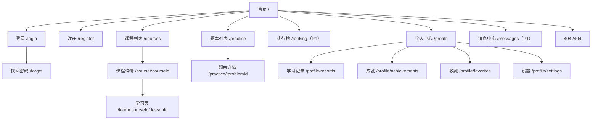
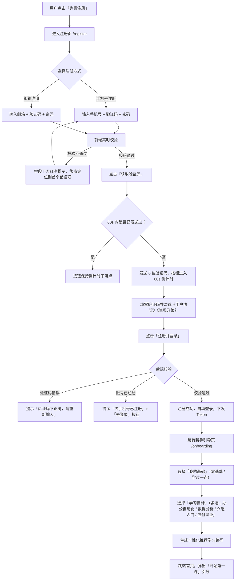
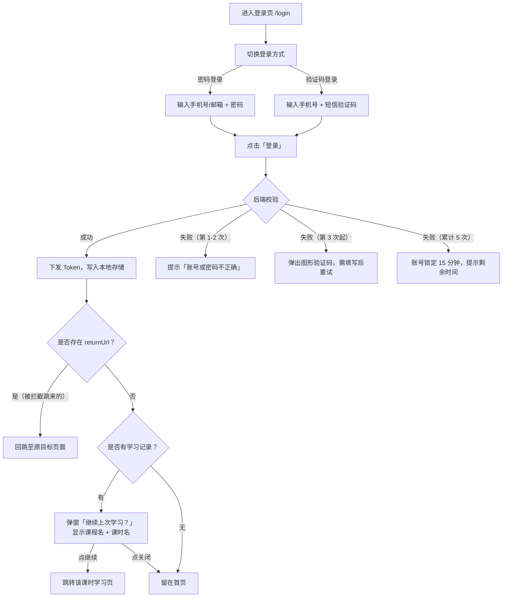
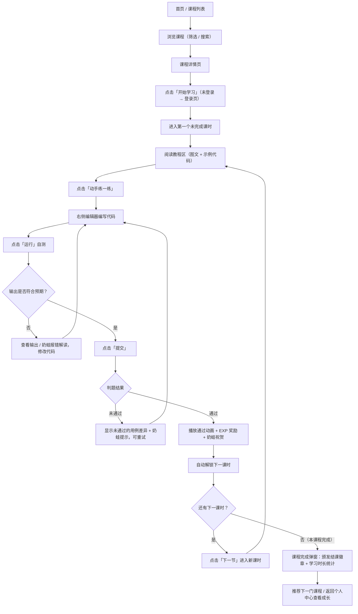
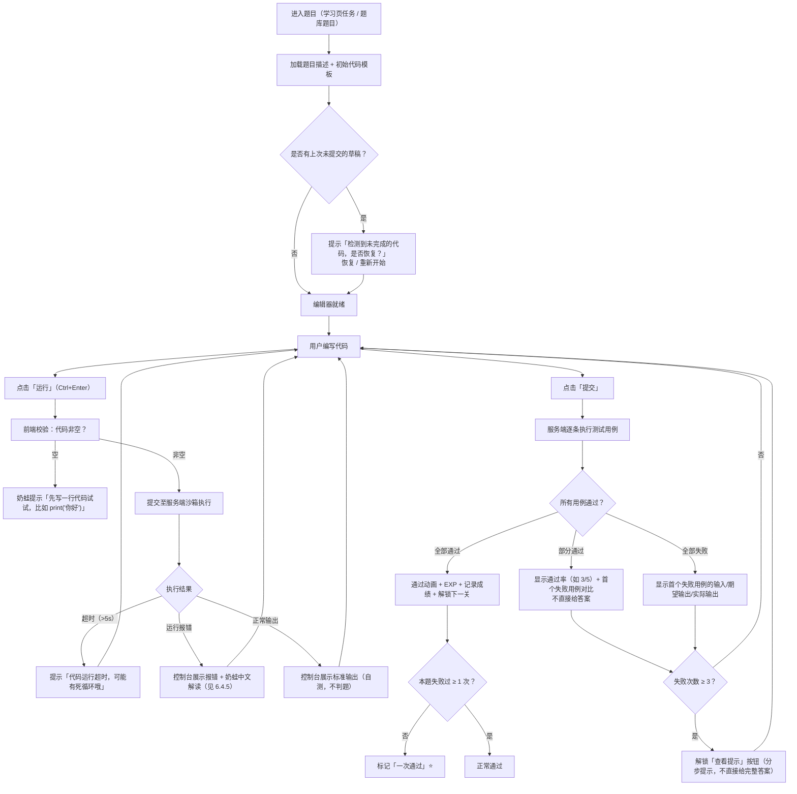
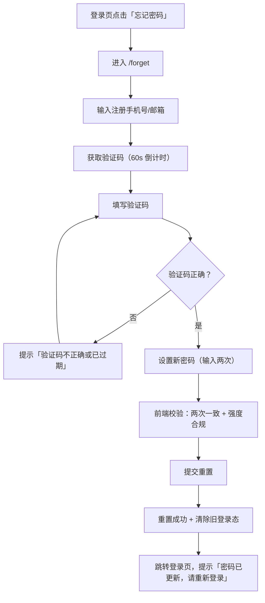
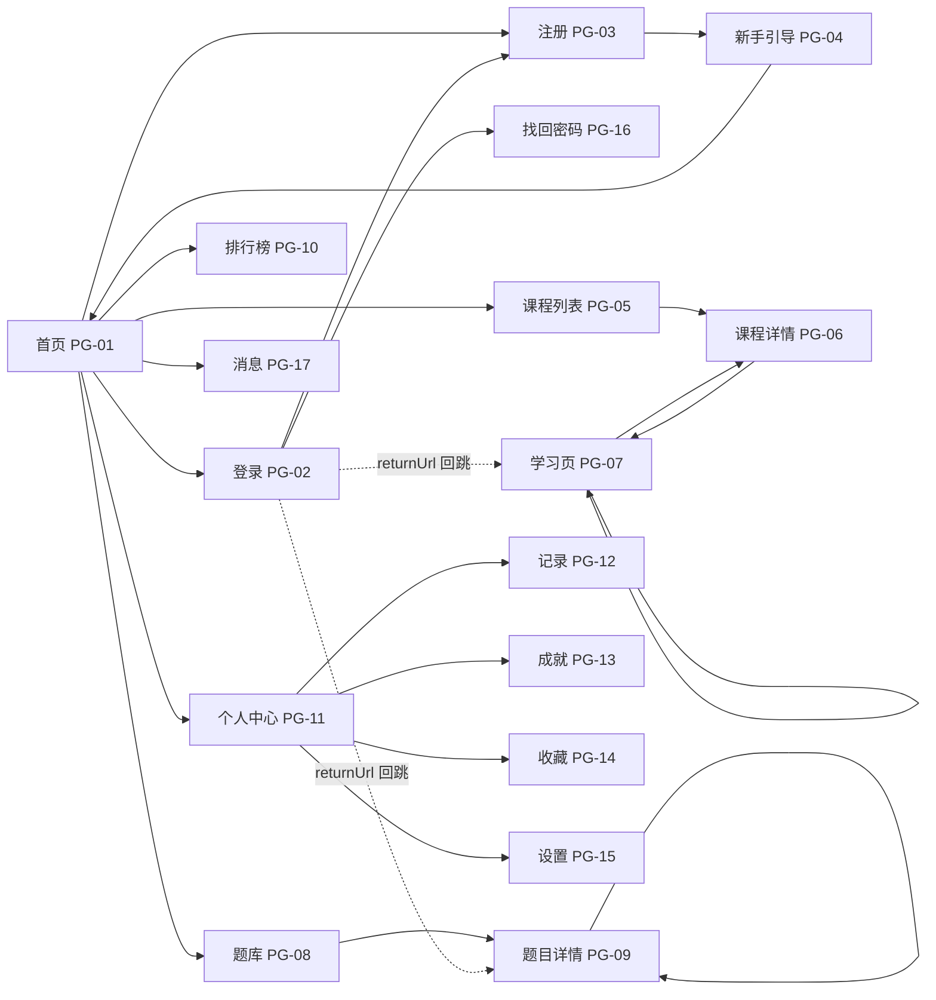
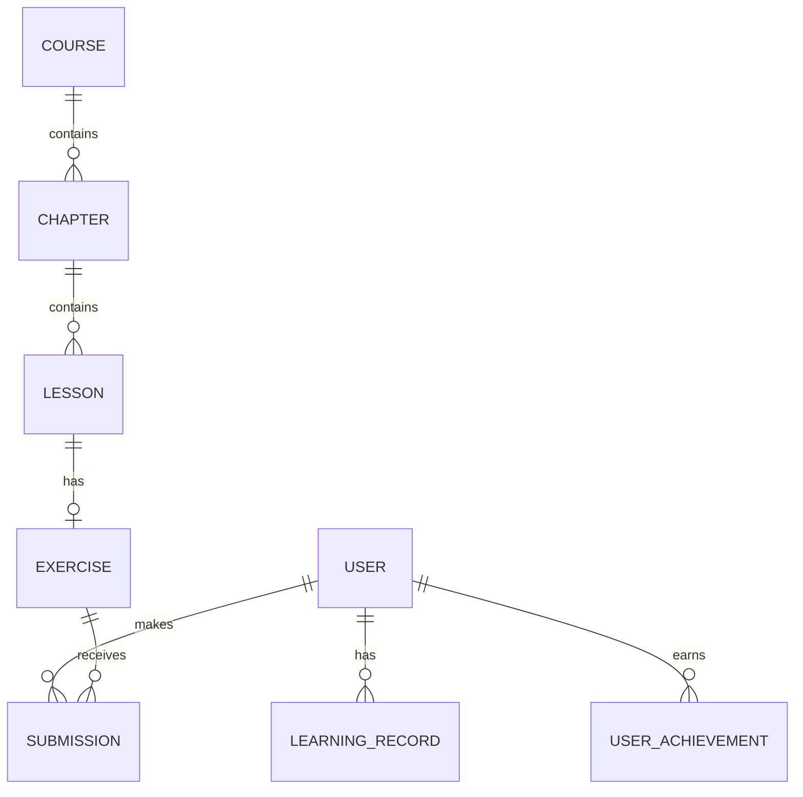

# 奶蛙 Python 学习平台 · 产品需求文档（PRD）

> 「和奶蛙一起，写下人生第一行代码。」

---

## 文档信息

| 项目 | 内容 |
| --- | --- |
| 文档名称 | 奶蛙 Python 学习平台 产品需求文档 |
| 英文代号 | Naiwa Python（项目代号：MilkFrog） |
| 文档版本 | V1.1 |
| 文档状态 | 修订稿 / 待评审 |
| 撰写日期 | 2026-10-08 |
| 撰写小组 | 第 15 组（组员：王坤浩、梁祯、姚亦涵、毛相亿） |
| 面向读者 | 前端开发、UI 设计、后端开发、测试、课程内容组 |
| 交付物 | 本文档（Markdown），作为后续前端界面开发的唯一需求依据 |

### 修订记录

| 版本 | 日期 | 修订人 | 修订说明 |
| --- | --- | --- | --- |
| V0.1 | 2026-10-06 | 产品组 | 初稿：产品定位、用户分析、功能结构 |
| V0.9 | 2026-10-07 | 产品组 + 设计组 | 补充视觉规范、页面跳转规则、交互逻辑 |
| V1.0 | 2026-10-08 | 全体 | 评审定稿，补充数据字段、埋点、迭代计划 |
| V1.1 | 2026-10-22 | 产品组 + 设计组 | IP 形象对齐网络「奶蛙」，补充 8 张已抠图的形象动作图；品牌配色由奶白 + 奶蛙绿调整为奶蛙黄 + 奶白，同步更新色彩、组件与页面示意 |

---

## 目录

1. [文档说明](#一文档说明)
2. [产品概述](#二产品概述)
3. [产品结构](#三产品结构)
4. [视觉与设计规范](#四视觉与设计规范)
5. [核心业务流程](#五核心业务流程)
6. [功能需求详述](#六功能需求详述)
7. [页面清单与跳转规则](#七页面清单与跳转规则)
8. [全局交互规范](#八全局交互规范)
9. [非功能性需求](#九非功能性需求)
10. [数据模型与接口字段（简版）](#十数据模型与接口字段简版)
11. [数据埋点](#十一数据埋点)
12. [迭代计划与优先级](#十二迭代计划与优先级)
13. [附录](#十三附录)

---

## 一、文档说明

### 1.1 文档目的

本文档描述「奶蛙 Python 学习平台」V1.1 的完整产品需求，包括产品定位、目标用户、功能模块、业务流程、页面跳转规则、交互逻辑与视觉规范。**前端开发可直接依据本文档第 4、6、7、8 章进行界面开发与联调**，第 10 章的字段示例可直接用于 Mock 数据搭建。

### 1.2 名词解释

| 名词 | 说明 |
| --- | --- |
| 奶蛙 | 平台品牌名与 IP 形象：一只黄色梨形身体、乳白肚皮的圆滚滚小青蛙，常捧腹大笑，是用户的学习伙伴与「陪学」人格化载体 |
| 课时（Lesson） | 学习的最小单位，一个课时 = 一篇教程 + 一个编程任务 |
| 章节（Chapter） | 若干课时的集合，课程的一级结构 |
| 学习闭环 | 「看教程 → 写代码 → 运行验证 → 通过判题 → 获得激励 → 下一课时」的完整循环 |
| 判题（Judge） | 用户提交代码后，系统用预置测试用例自动校验输出是否正确 |
| 沙箱（Sandbox） | 服务端隔离运行用户代码的环境，限制运行时长与资源，保证平台安全 |
| 断点续学 | 自动记录用户最后学习位置，下次进入可一键回到原处继续 |
| 连续打卡 | 用户连续多天有学习行为的记录，用于激励与成就体系 |
| 经验值（EXP） | 用户完成学习行为获得的成长点数，用于等级体系 |
| 优先级 P0/P1/P2 | P0 = MVP 必须；P1 = 第一版迭代内完成；P2 = 后续版本规划 |

### 1.3 需求编号规则

- 功能需求：`FR-模块号.序号`，如 `FR-1.2` 表示账号模块第 2 条需求；
- 非功能需求：`NFR-序号`，如 `NFR-3`；
- 页面编号：`PG-序号`，如 `PG-07` 学习页。

---

## 二、产品概述

### 2.1 产品定位

**一句话定位：**

> 奶蛙 Python 学习平台是一个面向**零基础学习者**的 Python 在线学习与编程训练平台，用「轻量教程 + 即时代码运行 + 闯关式训练 + 游戏化激励」的学习闭环，帮助初学者跨过「看得懂但写不出」和「一报错就想放弃」这两道坎。

**展开说明：**

| 维度 | 说明 |
| --- | --- |
| 产品类型 | Web 端在线学习 + 编程训练平台（响应式，优先适配 1280px 及以上桌面端） |
| 核心能力 | 教程阅读、浏览器内写码运行、自动判题、进度追踪、成就激励 |
| 与其他学习平台的区别 | ① 代码**即写即跑**，不用装环境；② 报错信息**翻译成人话**；③ 全程有「奶蛙」陪伴式引导，降低挫败感；④ 学习路径按「关卡」推进，目标感强 |
| 商业属性 | 本期以免费课程为主，不含付费与电商功能（会员增值在 V2.0 规划，见第 12 章） |

### 2.2 品牌与 IP 设定

**名称释义：** 「奶」= 温柔、低门槛、奶黄与奶白色系的视觉气质；「蛙」= 陪学伙伴的形象载体。合起来传递「学习 Python 可以很轻松」的心理暗示。

**Slogan：**

- 主 Slogan：**和奶蛙一起，写下人生第一行代码。**
- 辅助文案：慢慢来，每个小白都能学会 Python。

**IP 形象「奶蛙」设定：**

| 项目 | 设定 |
| --- | --- |
| 形象 | 参考中文互联网流行的「奶蛙」：**黄色梨形身体 + 乳白色大肚皮**，短手短脚；两颗凸起的圆眼睛（眼白微微泛青绿），一条「一字」嘴；标志动作是**捧腹大笑**，笑起来圆肚子一颤一颤（见下方形象图库） |
| 品牌化处理 | 保留「黄身体、白肚皮、凸圆眼、一字嘴、捧腹笑」五个识别特征，线条改为圆润的深褐描边、弱化网络原型的「抽象感」；肚皮上可印一个极简 `</>` 或 Python 蛇形小徽章作为品牌识别点。**课程作业阶段直接使用本次提供的参考图（已抠图）**；若后续对外商用，需按上述特征重新原创绘制，不直接使用网络原图 |
| 性格 | 松弛、慢性子、有耐心，永远鼓励你，把报错当成「游戏提示」而不是「考试不及格」；奶蛙的笑只用来陪你放松，**从不嘲笑用户的错误** |
| 出现场景 | 新手引导、加载中动画、报错解读、空状态插画、成就解锁、连续打卡提醒 |
| 文案人称 | 第一人称「奶蛙」，如：「这行代码差一点就对啦，再检查一下括号～」 |

**形象关键词：** 奶蛙黄、乳白肚皮、梨形圆身、凸圆眼、一字嘴、捧腹大笑、深褐描边。

**延展表情：** 大笑 / 眨眼 / 挠头 / 打瞌睡 / 断线 / 撒花，分别用于完成、引导、空状态、加载、网络错误、判题通过等场景。

**形象图库（已抠图为透明底 PNG，位于 `images/`，可直接用于 UI 与插画参考）：**

| 捧腹大笑（主形象） | 侧眼看 | 功夫招架 | 双手交叉抱胸 |
| :---: | :---: | :---: | :---: |
|  |  |  |  |
| 判题通过 · 成就解锁 · 完成课时 | 新手引导 · 默认陪学 | 挑战提示 · 趣味拦截 | 等待加载 · 自信提示 |

| 妖娆妩媚 | 平躺抬头 | 思考 | 惊讶 |
| :---: | :---: | :---: | :---: |
|  |  |  |  |
| 休息提醒 · 连续打卡 | 空状态 · 打瞌睡 · 无数据 | 报错解读 · 加载中 · 提示 | 失败反馈 · 重要提醒 · 网络错误 |

> 注：以上为课程作业演示素材，8 张图均已统一抠图为透明底 PNG；商用版本需替换为原创绘制。

**奶蛙语气示例（供文案与前端占位使用）：**

| 场景 | ✅ 推荐文案 | ❌ 避免文案 |
| --- | --- | --- |
| 判题失败 | 差一点点！奶蛙陪你看看输出哪里不一样～ | 答案错误 / Wrong Answer |
| 报错提示 | 这里少了一个右括号，Python 有点看不懂啦 | SyntaxError: invalid syntax |
| 完成课时 | 太棒了！你比 80% 的同龄学习者更快完成这一节 🎉 | 任务完成 |
| 空状态 | 这里还空空的，去挑一门课开始吧～ | 暂无数据 |

### 2.3 目标用户

**核心用户（P0）：零基础 / 弱基础的编程初学者**

| 用户画像 | 描述 | 核心诉求 |
| --- | --- | --- |
| 🎓 在校生 · 小林 | 19 岁，大一非计算机专业。想学 Python 应付课业与竞赛入门，看视频课能懂，但一动手就报错，报错看不懂就放弃 | 低成本试错、有人「陪着」、看得懂的报错解释 |
| 💼 职场人 · 张姐 | 29 岁，行政岗。想用 Python 处理 Excel、做简单自动化，学习时间碎片化（通勤 + 午休） | 碎片时间可学、进度自动保存、目标导向（学完就能用） |
| 🔄 转行求职者 · 阿杰 | 23 岁，应届生想转数据分析。需要系统刷题 + 项目练习证明能力，但被在线判题平台的英文界面和硬核难度劝退 | 中文友好、循序渐进的题库、可视化的成长记录 |

**次要用户（P1）：** 培训机构教师 / 高校助教 —— V2.0 规划「班级管理」，可查看学生学习进度（本期不含，见 2.7 范围边界）。

**明确非目标用户：** Python 中级以上开发者、算法竞赛选手。平台定位是「入门到能用」，不做硬核竞技。

### 2.4 用户需求分析（痛点 → 需求 → 功能）

| # | 用户痛点 | 典型场景 | 产品需求 | 对应功能 |
| --- | --- | --- | --- | --- |
| 1 | 环境配置劝退 | 装 Python / 配编辑器花了 2 小时，还没写第一行代码 | 打开浏览器就能写代码 | 在线编程（6.4）、免安装 |
| 2 | 报错看不懂 | 满屏英文报错，不知道错在哪一行 | 报错翻译成人话 + 高亮出错位置 | 报错友好化（FR-4.5） |
| 3 | 看懂 ≠ 会写 | 视频课看完了，合上就忘，写不出 | 边学边练，每个知识点配一道小题 | 课时任务、即时判题（6.4 / 6.5） |
| 4 | 缺乏正反馈 | 学了两周没成就感，放弃 | 进度可视化 + 成就 + 成长等级 | 个人中心、成就体系（6.6） |
| 5 | 不知道该学什么 | 资源太多，无从下手；顺序混乱 | 平台给出清晰的学习路径 | 课程体系、新手引导（FR-1.7） |
| 6 | 学习易中断、难坚持 | 学完一节不知道在哪继续 | 断点续学 + 连续打卡 | 继续学习卡片（FR-2.1）、打卡（6.6） |
| 7 | 时间碎片化 | 只有 15 分钟空闲 | 课时短小（8–15 分钟可完成） | 课时时长设计规范（6.3） |

### 2.5 竞品简析与差异化

| 竞品类型 | 代表 | 优点 | 不足（奶蛙的机会点） |
| --- | --- | --- | --- |
| 文档教程类 | 菜鸟教程、W3School | 免费、全、查得快 | 只能读不能练，读完就忘；无进度与激励 |
| 视频课程类 | 慕课网、B 站课程 | 讲解生动 | 观看 ≠ 编码，报错无人管；无即时反馈 |
| 在线判题类 | LeetCode、洛谷 | 判题权威、题量大 | 面向进阶，英文/硬核，新手劝退；无教程衔接 |
| 闯关学习类 | Codecademy、编程猫 | 交互式学习体验好 | 中文支持弱 / 低龄化；本地化场景不足 |

**结论（差异化定位）：** 奶蛙 = 中文友好的「教程 + 即时编码 + 判题」一体化，且用**陪学式文案与游戏化激励**解决「挫败感」这一新手最大流失原因。本质是把「学」和「练」缝合成一个不可分割的闭环，而不是两个独立模块。

### 2.6 产品目标与成功指标

| 层级 | 指标 | 目标值（上线后首季度） |
| --- | --- | --- |
| 北极星指标 | 每周完成 ≥1 个课时的活跃学习者数（WAL） | ≥ 1000 |
| 转化 | 注册页 → 注册成功转化率 | ≥ 60% |
| 激活 | 新手引导完成率 | ≥ 80% |
| 激活 | 首节完课率（注册后 24h 内完成第一个课时） | ≥ 70% |
| 留存 | 次日留存 / 7 日留存 | ≥ 45% / ≥ 35% |
| 参与 | 人均周学习时长 | ≥ 60 分钟 |
| 参与 | 单题平均重试次数（衡量"愿意再试"的挫败容忍度） | ≥ 2 次（不要低于 1.2） |

### 2.7 范围边界（本期不做）

| 不做的事 | 原因 | 规划 |
| --- | --- | --- |
| 付费课程 / 会员体系 | 本期验证学习闭环，不做商业化 | V2.0 |
| 教师端 / 班级管理后台 | 需求未收敛，投入产出比低 | V2.0 |
| 移动端 App | Web 响应式已可覆盖碎片场景 | V2.0+ |
| 社区 / 讨论区 | 内容冷启动风险高，先靠「奶蛙」拟人化陪伴替代 | V2.0 |
| 视频课程 | 制作成本高，且视频不利于闭环 | 不规划 |
| 多语言（Python 以外的语言） | 聚焦 Python 单点打透 | V3.0 |

---

## 三、产品结构

### 3.1 功能结构图

```mermaid
flowchart TD
    ROOT["奶蛙 Python 学习平台"]

    ROOT --> M1["1. 账号体系"]
    ROOT --> M2["2. 首页与发现"]
    ROOT --> M3["3. 课程学习"]
    ROOT --> M4["4. 编程训练"]
    ROOT --> M5["5. 个人中心"]
    ROOT --> M6["6. 消息与提醒"]

    M1 --> M1A["注册"]
    M1 --> M1B["登录"]
    M1 --> M1C["找回密码"]
    M1 --> M1D["第三方登录（P2）"]
    M1 --> M1E["新手引导"]

    M2 --> M2A["继续学习"]
    M2 --> M2B["推荐课程"]
    M2 --> M2C["每日一题"]
    M2 --> M2D["学习数据速览"]

    M3 --> M3A["课程列表"]
    M3 --> M3B["课程详情"]
    M3 --> M3C["学习页（教程 + 在线编码）"]
    M3 --> M3D["进度与解锁"]

    M4 --> M4A["题库列表"]
    M4 --> M4B["题目详情（编程题）"]
    M4 --> M4C["在线判题"]
    M4 --> M4D["闯关地图（P1）"]

    M5 --> M5A["学习概览"]
    M5 --> M5B["学习记录"]
    M5 --> M5C["成就与等级"]
    M5 --> M5D["我的收藏"]
    M5 --> M5E["设置"]

    M6 --> M6A["消息中心"]
    M6 --> M6B["学习提醒设置"]
```



### 3.2 站点地图（页面层级）



### 3.3 用户角色与权限

| 角色 | 说明 | 可访问范围 |
| --- | --- | --- |
| 游客（未登录） | 首次访问或未登录用户 | 首页、课程列表、课程详情、题目预览（不可提交）、登录/注册/找回密码 |
| 注册用户（已登录） | 完成注册的学习者，**核心角色** | 全部前台页面；提交判题、记录进度、使用个人中心 |
| 内容管理员（V2.0） | 平台运营，管理课程与题库 | 独立后台，与前台隔离，本期不做 |

**权限矩阵（核心页面）：**

| 页面 | 游客 | 登录用户 |
| --- | --- | --- |
| 首页 / 课程列表 / 课程详情 | ✅ 可浏览 | ✅ |
| 学习页（教程阅读） | ⛔ 点击「开始学习」→ 登录页 | ✅ |
| 学习页（运行 / 提交代码） | ⛔ | ✅ |
| 题目详情（查看描述） | ✅ 可查看 | ✅ |
| 题目详情（提交判题） | ⛔ 点击「提交」→ 登录页 | ✅ |
| 个人中心全部页面 | ⛔ 直接重定向登录 | ✅ |

---

## 四、视觉与设计规范

> 本章为 UI / 前端开发的强制执行标准。所有色值、字号、圆角、间距以本章为准。

### 4.1 设计关键词

**治愈、圆润、清爽、有陪伴感。** 避免：工业感、高饱和撞色、尖锐直角、过重的阴影。

设计语言三原则：

1. **奶白底 + 一抹奶蛙黄**：大面积奶白 / 奶黄留白，黄色只用于「可操作」「进行中」和「被奖励」的元素，让视线的落点永远清楚；深褐文字保证可读性，避免「满屏发黄」。
2. **圆润即友好**：卡片、按钮、输入框统一使用较大圆角（8–16px），重要插画区域的卡片可用 20px。
3. **奶蛙在场**：每个关键节点（加载、报错、完成、空状态）都有奶蛙的一句话，不让用户面对「冷冰冰的系统」。

### 4.2 色彩规范

#### 4.2.1 主色板

| 用途 | 名称 | 色值 | 说明 |
| --- | --- | --- | --- |
| 品牌主色 | 奶蛙黄 Primary-500 | `#FFC93C` | 品牌识别色：插画、进度条填充、选中态、大面积装饰图形 |
| 按钮悬停 | Primary-600 | `#EFA900` | hover 态按钮背景、装饰性图形 |
| 按钮按下 | Primary-700 | `#C98F00` | active 态按钮背景 |
| 文字 / 链接 | Primary-800 | `#8A5A00` | 正文中的链接、小号强调文字（对比度达标） |
| 浅色底 | Primary-100 | `#FFF4CC` | 选中背景、标签底色、次级按钮底色 |
| 极浅底 | Primary-50 | `#FFFBEB` | 区块背景、代码输出成功区底色 |
| 禁用 / 装饰 | Primary-300 | `#FFDE7A` | 禁用态按钮、装饰性图形 |

> ⚠️ 无障碍提示：正文（14px 及以下）中的彩色文字必须使用 `Primary-800`；`Primary-500` 仅用于图形与大面积色块，不用于小字号文字。**黄色主按钮使用深褐色文字 `#3D2E00`，不使用白字**（黄底白字对比度不足）。

#### 4.2.2 辅助色与功能色

| 用途 | 名称 | 色值 | 使用场景 |
| --- | --- | --- | --- |
| 辅助色 | 奶泡白 Secondary | `#FFF3D6` | 信息区块底色、插画肚皮色、次级卡片底色 |
| 强调色 | 焦糖棕 Accent | `#B5651D` | 每日一题、限时活动、重要引导 |
| 成功 | Success | `#52C41A` | 判题通过、操作成功 |
| 警告 | Warning | `#E8833A` | 提醒、风险提示、未完成提示（与奶蛙黄拉开差异） |
| 错误 | Error | `#FF6B6B` | 表单错误、判题失败、危险操作 |
| 信息 | Info | `#4DABF7` | 普通提示、链接补充说明 |
| 插画点缀 | 蛙眼青 Illust-Green | `#7FB8A4` | **仅用于插画**（眼白、小装饰），不用于 UI 控件 |

> 奖励、成就、经验值、打卡等「获得型」信息改用 `Primary-100` 浅黄底 + `Primary-800` 文字 + 图标表达，避免与主色黄混淆。

#### 4.2.3 中性色

| 用途 | 色值 | 使用场景 |
| --- | --- | --- |
| 页面背景 | `#FFFDF7` | 全局页面底色（奶白，微暖） |
| 卡片 / 容器 | `#FFFFFF` | 卡片、弹窗、面板 |
| 分割线 / 描边 | `#EFE7D6` | 分割线、卡片描边、输入框默认边框（暖灰） |
| 主文字 | `#3A3226` | 标题、正文（深可可灰，比纯黑柔和） |
| 次文字 | `#7A6F5C` | 辅助说明、时间戳、输入框标签 |
| 禁用 / 占位 | `#A69B86` | 占位符、禁用文字 |

#### 4.2.4 难度标签配色

| 难度 | 文字色 | 底色 | 说明 |
| --- | --- | --- | --- |
| 入门 | `#8A5A00` | `#FFF4CC` | 零基础可学（奶蛙黄） |
| 进阶 | `#C05621` | `#FFEDD5` | 需完成前置课程（焦糖橙） |
| 挑战 | `#C0392B` | `#FFF1F0` | 综合实战（红） |

> 标签同时使用「文字 + 颜色」双通道区分（如「入门」二字），不依赖颜色单独传达信息（色盲友好）。

#### 4.2.5 前端 CSS 变量（可直接复制）

```css
:root {
  /* 主色：奶蛙黄 */
  --naiwa-primary: #ffc93c;
  --naiwa-primary-600: #efa900;
  --naiwa-primary-700: #c98f00;
  --naiwa-primary-800: #8a5a00;
  --naiwa-primary-100: #fff4cc;
  --naiwa-primary-50: #fffbeb;
  --naiwa-primary-300: #ffde7a;

  /* 辅助 / 功能 */
  --naiwa-secondary: #fff3d6;
  --naiwa-accent: #b5651d;
  --naiwa-success: #52c41a;
  --naiwa-warning: #e8833a;
  --naiwa-error: #ff6b6b;
  --naiwa-info: #4dabf7;
  --naiwa-illust-green: #7fb8a4; /* 仅插画点缀 */

  /* 中性 */
  --naiwa-bg: #fffdf7;
  --naiwa-surface: #ffffff;
  --naiwa-border: #efe7d6;
  --naiwa-text-primary: #3a3226;
  --naiwa-text-secondary: #7a6f5c;
  --naiwa-text-disabled: #a69b86;
  --naiwa-button-text: #3d2e00; /* 黄底按钮专用深褐文字 */

  /* 代码编辑器 */
  --naiwa-code-bg: #fffdf7;
  --naiwa-code-gutter: #f7f1e3;

  /* 圆角 */
  --radius-sm: 4px;
  --radius-md: 8px;
  --radius-lg: 12px;
  --radius-xl: 20px;
  --radius-full: 999px;

  /* 阴影（柔和、低对比，暖褐色投影） */
  --shadow-1: 0 2px 8px rgba(58, 50, 38, 0.06);
  --shadow-2: 0 6px 20px rgba(58, 50, 38, 0.10);

  /* 间距（8px 栅格） */
  --space-1: 4px;
  --space-2: 8px;
  --space-3: 12px;
  --space-4: 16px;
  --space-5: 24px;
  --space-6: 32px;
  --space-7: 48px;
}
```

### 4.3 字体与排版

| 用途 | 字体栈 | 字号 | 字重 | 行高 |
| --- | --- | --- | --- | --- |
| 页面大标题 | `"HarmonyOS Sans SC", "PingFang SC", "Microsoft YaHei", sans-serif` | 28–32px | 600 | 1.4 |
| 模块标题 | 同上 | 20px | 600 | 1.4 |
| 卡片标题 | 同上 | 16px | 600 | 1.5 |
| 正文 | 同上 | 14px | 400 | 1.7（教程正文 1.8） |
| 辅助说明 | 同上 | 12px | 400 | 1.5 |
| 代码（编辑器与代码块） | `"JetBrains Mono", "Fira Code", Consolas, monospace` | 14px | 400 | 1.6 |

- 数字类数据（学习时长、经验值等）使用等宽字体，视觉更整齐；
- 编辑器缩进：**Tab = 4 个空格**（Python 规范），编辑器需自动把 Tab 转为 4 空格。

### 4.4 图标与插画规范

| 类型 | 规范 |
| --- | --- |
| 功能图标 | 线性风格，2px 描边，圆头端点；默认 `#7A6F5C`，悬停/选中 `#8A5A00`（黄色明度太高，不用于细线图标）；推荐图标库：IconPark / Lucide |
| 奶蛙插画 | 扁平风 + 柔和渐变，**奶蛙黄身体 + 奶泡白肚皮 + 深褐描边**，眼白可点少量 `#7FB8A4`；用于空状态、加载、成就、错误页 |
| 奶蛙造型 | 以 [2.2 形象图库](#22-品牌与-ip-设定) 的 8 个动作为造型基准：黄色梨形圆身、乳白大肚皮、凸圆眼、一字嘴、短手短脚；默认表情为捧腹大笑，可按场景切换侧眼 / 招架 / 抱胸 / 妩媚 / 平躺 / 思考 / 惊讶 |
| 空状态插画 | 尺寸 160×160px，配一句奶蛙文案 + 1 个主行动按钮 |
| 加载动画 | 奶蛙眨眼/跳动的 Lottie 动画（≤100KB），降级方案为 3 个奶蛙黄圆点循环跳动 |

### 4.5 布局与栅格

| 项目 | 规范 |
| --- | --- |
| 内容最大宽度 | 1200px（居中，左右留白 ≥ 24px） |
| 栅格 | 12 列，列间距 24px |
| 桌面适配 | ≥ 1280px 完整布局（设计基准 1440px） |
| 小屏适配 | 1024–1280px：内容区收缩，侧栏可折叠 |
| 移动端 | < 768px 本期仅保证「可浏览、可学习」的降级体验（P2 做精细适配） |
| 学习页布局 | 三栏：左目录 240px 固定 / 中教程自适应 / 右代码区最小 420px，可拖拽分割条调整 |

### 4.6 组件规范

#### 主按钮（Primary Button）

| 状态 | 背景 | 文字 | 其他 |
| --- | --- | --- | --- |
| 默认 | `#FFC93C` | `#3D2E00` | 圆角 8px，高度 40px，左右内边距 20px |
| 悬停 | `#EFA900` | `#3D2E00` | 过渡 0.2s ease |
| 按下 | `#C98F00` | `#3D2E00` | 轻微缩放 0.98 |
| 加载中 | `#FFC93C` | 深褐文字 + 旋转图标 | 禁止重复点击 |
| 禁用 | `#FFEEB8` | `#A69B86` | `cursor: not-allowed` |

#### 输入框（Input）

| 状态 | 边框 | 背景 | 说明 |
| --- | --- | --- | --- |
| 默认 | 1px `#EFE7D6` | `#FFFFFF` | 圆角 8px，高度 40px，占位符 `#A69B86` |
| 悬停 | 1px `#FFDE7A` | `#FFFFFF` | — |
| 聚焦 | 1px `#FFC93C` + 外发光 `0 0 0 3px rgba(255,201,60,.25)` | `#FFFFFF` | — |
| 错误 | 1px `#FF6B6B` + 外发光红 | `#FFF8F8` | 下方 12px 红字错误提示 |
| 禁用 | 1px `#EFE7D6` | `#FAF6EC` | 文字 `#A69B86` |

#### 卡片（Card）

- 背景 `#FFFFFF`，圆角 12px，阴影 `var(--shadow-1)`，内边距 20–24px；
- 悬停（可点击卡片）：上浮 2px + 阴影升级为 `var(--shadow-2)`，过渡 0.2s。

#### 标签（Tag）

- 圆角 4px，高度 22px，字号 12px，内边距 4px 8px，使用 4.2.4 配色。

#### 奶蛙气泡提示（FrogTip）

- 结构：奶蛙头像（32×32）+ 对话气泡（圆角 12px，背景 `#FFFBEB`，文字 `#3A3226`，可选 1px `#FFDE7A` 描边）；
- 使用场景：引导、报错解读、成就提示；同页面同时最多显示 1 条。

### 4.7 文案语气规范

| 原则 | 说明 |
| --- | --- |
| 用第二人称 | 「你再试试看」而非「建议用户重试」 |
| 说人话 | 所有技术术语（如 SyntaxError）必须在界面中翻译为中文解释 |
| 先肯定再指出 | 判题/报错场景先鼓励再给方向，禁止贬低性语言 |
| 短句 | 单条提示 ≤ 30 字，超出使用「查看更多」 |

---

## 五、核心业务流程

### 5.1 注册流程



**关键规则：**

| 规则项 | 说明 |
| --- | --- |
| 协议勾选 | 《用户协议》与《隐私政策》**默认不勾选**，未勾选时「注册」按钮置灰并提示 |
| 验证码有效期 | 5 分钟；同一手机号 1 分钟内仅可发送 1 次，单日最多 10 次 |
| 注册即登录 | 注册成功后免二次登录，直接下发登录态 |
| 新手引导可跳过 | 引导页提供「先逛逛」按钮，跳过不阻断，但下次登录首页仍会显示引导入口 |

### 5.2 登录与鉴权流程



**关键规则：**

| 规则项 | 说明 |
| --- | --- |
| 登录态有效期 | 7 天（「记住我」勾选时）；未勾选时为会话级，关闭浏览器失效 |
| 回跳规则 | 任何受保护页面被拦截时，登录成功后**必须**回跳原页面并携带原参数 |
| 错误提示 | 出于安全，不区分「账号不存在」与「密码错误」，统一提示「账号或密码不正确」 |
| Token 过期 | 接口返回 401 → 清除本地登录态 → 跳登录页（携带 returnUrl）→ 提示「登录已过期，请重新登录」 |

### 5.3 课程学习闭环（核心业务主流程）



**关键规则：**

| 规则项 | 说明 |
| --- | --- |
| 完成判定 | 含练习的课时：练习判题通过 = 完成；纯理论课时（无练习）：滚动至教程底部并停留 ≥ 2s，出现「标记为已学完」按钮，点击后完成 |
| 解锁规则 | 默认**顺序解锁**：完成前一节后解锁下一节。未解锁课时在目录中显示 🔒，点击时提示「先完成上一节吧，奶蛙在这里等你」并定位到当前应学课时 |
| 跳过规则 | 用户可在目录中**自由回看**任何已完成课时；**不可跳级** |
| 进度计算 | 课程进度 = 已完成课时数 ÷ 总课时数，四舍五入到整数百分比 |
| 断点记录 | 每次进入课时、每次判题提交、每次离开学习页，均上报 `lastLessonId`（节流：最长 30s 上报一次） |
| 课程完成 | 所有课时完成 → 课程状态置为「已完成」，个人中心计入「已完成课程数」，发放结课徽章 |

### 5.4 在线编程与判题流程



**关键规则：**

| 规则项 | 说明 |
| --- | --- |
| 运行 vs 提交 | 「运行」= 用用户自己的输入自测，**不**判题、不计分；「提交」= 用官方测试用例判题、计分 |
| 沙箱限制 | 单次执行超时 5 秒，内存上限 128MB，禁止文件系统与网络访问（后端实现，前端只需处理对应错误码） |
| 防刷限制 | 同一用户提交间隔 ≥ 5 秒；单题单日提交上限 100 次（超出提示「休息一下，明天再来～」） |
| 草稿保存 | 编辑器内容每 30 秒自动保存草稿（本地 localStorage 优先，登录用户同步云端）；关闭页面前如有未提交修改，弹出确认弹窗 |
| 提示阶梯 | 第 1 级：指出方向；第 2 级：指出应该用的知识点；第 3 级：给出关键一行代码。每级递进，避免直接给答案 |
| 成绩判定 | 一次通过（⭐）/ 通过 / 未通过，用于闯关星级与成就统计 |

### 5.5 找回密码流程



---

## 六、功能需求详述

> 本章为前端开发的核心依据。每条需求含：功能说明、页面要素、交互逻辑、异常处理、验收标准。

### 6.1 模块一：账号体系（登录 / 注册）

#### 6.1.1 功能清单

| 编号 | 功能 | 说明 | 优先级 |
| --- | --- | --- | --- |
| FR-1.1 | 用户注册 | 手机号 / 邮箱注册，验证码校验 | P0 |
| FR-1.2 | 用户登录 | 密码登录 + 验证码登录双模式 | P0 |
| FR-1.3 | 找回密码 | 验证码重置密码 | P0 |
| FR-1.4 | 退出登录 | 清除登录态返回首页 | P0 |
| FR-1.5 | 记住我 | 7 天免登录 | P1 |
| FR-1.6 | 图形验证码 | 登录失败 3 次后触发 | P1 |
| FR-1.7 | 新手引导 | 首次注册后选择基础与目标，生成学习路径 | P0 |
| FR-1.8 | 第三方登录（微信 / GitHub） | 一键授权登录 | P2 |

#### 6.1.2 登录页（PG-02 · /login）

**页面结构（线框图）：**

```
┌────────────────────────────────────────────────────────────────────┐
│                                                                    │
│   ┌──────────────────────┐   ┌──────────────────────────────┐    │
│   │                      │   │  欢迎回来，继续你的 Python 之旅 │    │
│   │      🐸 奶蛙插画       │   │                              │    │
│   │   （捧腹笑，眨眼动画）  │   │  ┌────────────────────────┐  │    │
│   │                      │   │  │ 📱 手机号/邮箱           │  │    │
│   │  「今天也一起学两行    │   │  └────────────────────────┘  │    │
│   │     Python 吧～」      │   │  ┌────────────────────────┐  │    │
│   │                      │   │  │ 🔒 密码          👁 显示 │  │    │
│   │                      │   │  └────────────────────────┘  │    │
│   └──────────────────────┘   │                              │    │
│                              │  ☐ 记住我       忘记密码？     │    │
│                              │                              │    │
│                              │  ┌────────────────────────┐  │    │
│                              │  │      登  录  (主按钮)    │  │    │
│                              │  └────────────────────────┘  │    │
│                              │  ─────────── 或 ───────────   │    │
│                              │  ┌────────────────────────┐  │    │
│                              │  │  💬 验证码登录           │  │    │
│                              │  └────────────────────────┘  │    │
│                              │    还没有账号？ 免费注册 →     │    │
│   └──────────────────────┘   └──────────────────────────────┘    │
└────────────────────────────────────────────────────────────────────┘
```

**页面要素与交互：**

| 要素 | 交互说明 |
| --- | --- |
| 奶蛙插画区 | 左侧固定区域（≥1280px 显示，小屏隐藏）；黄色梨形奶蛙默认捧腹大笑，带轻微呼吸/眨眼动画；文案每次进入随机切换一条鼓励语 |
| 账号输入框 | 支持手机号（11 位）与邮箱两种格式，自动识别；输入框失焦时校验格式 |
| 密码输入框 | 默认密文；右侧「👁」图标切换明文，图标切换时**保持焦点**在输入框 |
| 记住我 | 勾选后登录态保持 7 天；默认不勾选 |
| 忘记密码 | 文案链接 → /forget |
| 登录按钮 | 点击后进入 loading（按钮内旋转图标 + 文案变「登录中…」），期间禁止重复提交 |
| 验证码登录 | 切换为「手机号 + 验证码」表单，布局复用，切换不刷新页面（tab 切换或按钮切换均可，推荐 tab 样式） |
| 免费注册 | 跳转 /register |
| 回车提交 | 表单内按 Enter = 点击登录 |

**异常处理：**

| 场景 | 处理 |
| --- | --- |
| 输入为空点击登录 | 按钮置灰不可点（空表单状态）；若用户强行提交则聚焦首个空字段并提示 |
| 格式错误 | 输入框红框 + 下方红字，如「手机号格式不正确」 |
| 账号或密码错误 | 表单顶部整体提示条（红底浅色）「账号或密码不正确，请重试」，输入框不清空 |
| 网络异常 | Toast：「网络开小差了，请检查网络后重试」+ 「重试」按钮 |
| 连续失败 3 次 | 表单内展开图形验证码（4 位字符 / 滑块二选一，实现建议用滑块），验证码错误仅刷新验证码不清空表单 |
| 账号锁定 | 提示「尝试次数过多，请 15 分钟后再试」，按钮禁用并显示倒计时 |
| returnUrl 存在 | 登录成功后回跳原页面（如 `/learn/py-basic-01/lesson-3`），并 toast 提示「登录成功，继续学习吧～」 |

#### 6.1.3 注册页（PG-03 · /register）

**页面结构（线框图）：**

```
┌────────────────────────────────────────────────────────────────────┐
│  ┌──────────────────────┐   ┌──────────────────────────────┐      │
│  │      🐸 奶蛙插画       │   │  加入奶蛙，从第一行代码开始     │      │
│  │  「注册只要 10 秒，     │   │                              │      │
│  │    然后我们开始写代码」  │   │  ┌────────────────────────┐  │      │
│  │                      │   │  │ 📱 手机号                │  │      │
│  │                      │   │  └────────────────────────┘  │      │
│  │                      │   │  ┌──────────────┐┌─────────┐  │      │
│  │                      │   │  │ 验证码        ││ 获取验证码│  │      │
│  │                      │   │  └──────────────┘└─────────┘  │      │
│  │                      │   │  ┌────────────────────────┐  │      │
│  │                      │   │  │ 🔒 设置密码（8-20位）     │  │      │
│  │                      │   │  └────────────────────────┘  │      │
│  │                      │   │  ▓▓▓▓░░ 强度：中             │      │
│  │                      │   │  ☐ 我已阅读并同意《用户协议》  │      │
│  │                      │   │     和《隐私政策》            │      │
│  │                      │   │  ┌────────────────────────┐  │      │
│  │                      │   │  │   注册并登录 (主按钮)     │  │      │
│  │                      │   │  └────────────────────────┘  │      │
│  │                      │   │    已有账号？ 直接登录 →      │      │
│  └──────────────────────┘   └──────────────────────────────┘      │
└────────────────────────────────────────────────────────────────────┘
```

**页面要素与交互：**

| 要素 | 交互说明 |
| --- | --- |
| 手机号 / 邮箱切换 | 顶部提供「手机号注册 / 邮箱注册」两个 tab，切换时清空已填的账号与验证码字段 |
| 获取验证码按钮 | 点击后校验账号格式 → 通过则按钮变为「60s 后重发」倒计时置灰；未通过则提示格式错误且不发送 |
| 密码强度条 | 实时计算（弱/中/强），颜色对应 错误红 / 警告橙 / 成功绿；强度规则见下表 |
| 协议勾选 | 默认不勾选；未勾选时点击注册 → 表单抖动 + 提示「请先阅读并同意协议」，同时协议链接高亮闪烁 1 次 |
| 协议链接 | 点击《用户协议》《隐私政策》→ 弹窗展示全文（不跳转新页面，避免丢失已填内容） |
| 注册按钮 | 提交时做全量校验；成功后自动登录 → 跳转 /onboarding |

**校验规则表（全局通用，登录/注册/找回密码共用）：**

| 字段 | 规则 | 错误提示文案 |
| --- | --- | --- |
| 手机号 | 中国大陆 11 位，`1[3-9]\d{9}` | 手机号格式不正确，请检查后重试 |
| 邮箱 | 标准邮箱格式，≤ 64 字符 | 邮箱格式不正确 |
| 密码 | 8–20 位，须同时包含字母和数字，允许特殊符号，不允许空格 | 密码需 8-20 位，且包含字母和数字 |
| 密码强度 | 弱：纯数字或纯字母；中：字母+数字；强：字母+数字+特殊符号且 ≥ 12 位 | —（仅展示强度条，不阻断提交） |
| 验证码 | 6 位数字 | 验证码不正确，请重新输入 |
| 昵称（引导页/设置页） | 2–12 个字符，中英文、数字、下划线，不可与其他用户重复 | 昵称需 2-12 个字符，支持中英文、数字、下划线 |
| 确认密码 | 与密码一致 | 两次输入的密码不一致 |

**校验时机规范：**

1. **失焦校验（onBlur）**：用户离开该字段时校验该字段；
2. **实时纠错（onInput）**：仅当字段已处于错误态时，输入过程中实时清除错误提示；
3. **提交校验（onSubmit）**：全量校验，焦点自动定位到**第一个**错误字段，并平滑滚动至可视区。

#### 6.1.4 新手引导页（PG-04 · /onboarding）

| 步骤 | 内容 | 交互 |
| --- | --- | --- |
| 步骤 1/2 | 「你的 Python 基础？」选项卡片：A. 完全零基础（推荐）B. 学过一点点 | 单选卡片，选中态奶蛙黄描边 + `#FFF4CC` 浅黄底 + 右上角对勾 |
| 步骤 2/2 | 「你想用 Python 做什么？」多选：办公自动化 / 数据分析 / 兴趣入门 / 应付课业 | 多选，最多选 2 个；选「兴趣入门」与其他互斥 |
| 完成 | 「奶蛙为你定制了学习路线」→ 展示推荐课程卡片 → 按钮「开始第一课」 | 跳转推荐课程详情页或直接进入第一课时 |

- 顶部有进度指示（1 ●○ 2）；提供「先逛逛」跳过入口（文字按钮，弱化处理）；
- 引导数据用于首页推荐排序，可在「个人中心-设置」中修改。

#### 6.1.5 验收标准（Account 模块）

- [ ] 未登录用户点击任何需要登录的入口，均被正确拦截至登录页；
- [ ] 登录成功后正确回跳原目标页面且参数不丢失；
- [ ] 注册流程中验证码倒计时、协议未勾选拦截、重复注册提示均符合本文档描述；
- [ ] 表单校验时机（失焦/提交）、错误文案、焦点定位与本文档完全一致；
- [ ] 登录失败 3 次出现图形验证码，5 次锁定 15 分钟并有倒计时提示；
- [ ] Token 过期后访问受保护页面，正确清理状态并跳转登录。

### 6.2 模块二：首页与发现（PG-01 · /）

#### 6.2.1 功能清单

| 编号 | 功能 | 说明 | 优先级 |
| --- | --- | --- | --- |
| FR-2.1 | 继续学习卡片 | 展示上次学习位置，一键续学 | P0 |
| FR-2.2 | 推荐课程 | 基于新手引导目标推荐课程 | P0 |
| FR-2.3 | 每日一题 | 每天更新一道题，可跳转作答 | P1 |
| FR-2.4 | 学习数据速览 | 累计学习天数、时长、完成课时 | P1 |
| FR-2.5 | 排行榜入口 | 展示周学习时长 TOP 榜 | P1 |
| FR-2.6 | 未登录态首页 | 平台介绍 + 引导注册 | P0 |

#### 6.2.2 页面结构（已登录态线框图）

```
┌──────────────────────────────────────────────────────────────────────┐
│ 🐸 奶蛙Python   首页  课程  训练  排行榜        🔔  👤头像 ▾           │  ← 顶部导航(64px, 白底吸顶)
├──────────────────────────────────────────────────────────────────────┤
│                                                                      │
│  ┌────────────────────────────────────────────────────────────────┐  │
│  │ 🐸 「欢迎回来，小林！继续昨天没学完的那一节吧～」                  │  │
│  │                                                                │  │
│  │  Python 零基础入门 · 第 3 章 变量 · 3.2 字符串          ▓▓▓▓░ 62%│  │
│  │  [ ▶ 继续学习 ]                                                │  │
│  └────────────────────────────────────────────────────────────────┘  │
│  ← 继续学习卡片（主色浅底 #FFF4CC，圆角 16px）                        │
│                                                                      │
│  ┌───────────────────────┐ ┌───────────────────────┐ ┌─────────────┐ │
│  │ 📅 每日一题 · 已打卡 7 天│ │ 📊 本周学习 3.5 小时    │ │ 🏅 等级      │ │
│  │ 打印你的名字  →         │ │ 完成 12 个课时          │ │ 快乐奶蛙 Lv.3│ │
│  └───────────────────────┘ └───────────────────────┘ └─────────────┘ │
│                                                                      │
│  为你推荐                                      查看全部课程 →        │
│  ┌───────────┐ ┌───────────┐ ┌───────────┐ ┌───────────┐            │
│  │  课程封面   │ │  课程封面   │ │  课程封面   │ │  课程封面   │   ← 卡片悬停上浮
│  │ Python入门  │ │ 办公自动化   │ │ 数据分析基础 │ │ 游戏编程入门 │            │
│  │ 🟡入门 32课时│ │ 🟠进阶 18课时│ │ 🟠进阶 24课时│ │ 🔴挑战 20课时│            │
│  │ ▓▓▓▓░░ 62% │ │ 未开始      │ │ 未开始      │ │ 未开始      │            │
│  └───────────┘ └───────────┘ └───────────┘ └───────────┘            │
│                                                                      │
│  学习路线（基于你的目标：数据分析）                                    │
│  ●━━━━━●━━━━━○━━━━━○━━━━━○   1.入门 2.数据结构 3.数据处理 4.可视化 5.实战│
└──────────────────────────────────────────────────────────────────────┘
```

#### 6.2.3 交互逻辑

| 要素 | 交互说明 |
| --- | --- |
| 继续学习卡片 | 取 `lastLessonId`；点击「继续学习」直达该课时；无学习记录时该卡片替换为「开始第一课」引导卡 |
| 每日一题 | 每天 00:00 更新；完成后卡片变为「今日已打卡 ✅ + 连续 N 天」；点击未完成 → 题目详情页 |
| 推荐课程 | 排序规则：新手引导目标匹配 > 难度匹配 > 热度；未登录用户展示全平台热门课程 |
| 课程卡片 | 整卡可点击 → 课程详情页；悬停上浮 2px；已学课程卡片显示进度条 |
| 顶部导航 | 吸顶；导航项当前页高亮（`Primary-800` 文字 + 底部 2px `Primary-500` 指示条）；右侧铃铛为消息入口（有未读时显示红点） |
| 未登录态 | 继续学习卡片替换为「加入奶蛙，免费开始学 Python」+ 注册按钮；每日一题改为「登录后可打卡」 |

#### 6.2.4 验收标准

- [ ] 未登录与已登录两套首页布局均与本文档一致；
- [ ] 继续学习卡片在无记录、有记录、课程已完成三种状态下展示正确；
- [ ] 所有卡片点击跳转目标与第 7 章跳转规则表一致。

### 6.3 模块三：课程模块（列表 / 详情）

#### 6.3.1 功能清单

| 编号 | 功能 | 说明 | 优先级 |
| --- | --- | --- | --- |
| FR-3.1 | 课程列表 | 筛选（难度/方向）、排序、搜索 | P0 |
| FR-3.2 | 课程详情 | 简介、大纲、学习目标、开始/继续学习 | P0 |
| FR-3.3 | 课程大纲 | 章节目录 + 锁定状态 + 完成状态 | P0 |
| FR-3.4 | 课程搜索 | 关键词搜索（标题、标签） | P1 |
| FR-3.5 | 学习进度展示 | 卡片与详情页展示进度 | P0 |

#### 6.3.2 课程列表页（PG-05 · /courses）

**页面结构：**

```
┌──────────────────────────────────────────────────────────────────────┐
│  🐸 奶蛙Python   首页  课程  训练  排行榜        🔔  👤头像 ▾          │
├──────────────────────────────────────────────────────────────────────┤
│  全部课程                                        [🔍 搜索课程...    ]  │
│                                                                      │
│  难度： [全部] [入门] [进阶] [挑战]                                      │
│  方向： [全部] [基础语法] [办公自动化] [数据分析] [趣味编程]               │
│  状态： [全部] [学习中] [已完成]          ← 已登录且有必要时才显示状态筛选   │
│                                                                      │
│  ┌────────────┐  ┌────────────┐  ┌────────────┐  ┌────────────┐    │
│  │   封面图     │  │            │  │            │  │            │    │
│  │ Python 零基础│  │ Excel 自动化 │  │ 数据分析入门 │  │ 小游戏开发   │    │
│  │ 🟡入门·32课时│  │ 🟠进阶·18课 │  │ 🟠进阶·24课 │  │ 🔴挑战·20课 │    │
│  │ 1.2万人学过  │  │ 8000人学过   │  │ 6500人学过   │  │ 3200人学过   │    │
│  │ ▓▓▓▓░░ 62% │  │ [开始学习]   │  │ [开始学习]   │  │ [开始学习]   │    │
│  └────────────┘  └────────────┘  └────────────┘  └────────────┘    │
│                                                                      │
│                        < 1  2  3 ... >   （分页，每页 12 条）            │
└──────────────────────────────────────────────────────────────────────┘
```

**交互逻辑：**

| 要素 | 交互说明 |
| --- | --- |
| 筛选器 | 单选标签组；点击即生效（无需「确定」按钮）；多个筛选组之间为「与」关系；筛选变化时不刷新整页，仅局部刷新列表（保留滚动位置可选） |
| 搜索框 | 输入 ≥ 2 字符后 300ms 防抖触发搜索；支持清空按钮；无结果时显示空状态插画 + 「没有找到相关课程，换个关键词试试？」 |
| 课程卡片 | 未开始显示「开始学习」按钮；学习中显示进度条 + 「继续学习」；已完成显示 ✅ 「已完成」+ 「再学一遍」 |
| 分页 | 每页 12 条；滚动到列表底部时显示分页器；切换分页后回到列表顶部 |
| 列表加载 | 首屏使用骨架屏（3×4 卡片灰块），不使用全屏 loading |

#### 6.3.3 课程详情页（PG-06 · /course/:courseId）

**页面结构：**

```
┌──────────────────────────────────────────────────────────────────────┐
│  首页 / 课程 / Python 零基础入门                                       │  ← 面包屑
├──────────────────────────────────────────────────────────────────────┤
│  ┌────────────────┐   Python 零基础入门            🟡 入门              │
│  │                │   一句话简介：从 print 开始，学会写你的第一个程序     │
│  │    课程封面      │   ★ 4.9  |  1.2 万人学过  |  32 课时  |  约 8 小时 │
│  │   （大图）       │                                                    │
│  │                │   ┌──────────────────────────────────────┐        │
│  │                │   │  ▶ 开始学习 / 继续学习（第 3 章 3.2）   │        │
│  └────────────────┘   └──────────────────────────────────────┘        │
│                                                                      │
│  ── 你将学到什么 ────────────────────────────────                     │
│  ✅ 变量与数据类型   ✅ 条件与循环   ✅ 函数   ✅ 文件操作   ✅ 实战小项目 │
│                                                                      │
│  ── 课程大纲 ──                                   总进度 ▓▓▓▓░ 62%    │
│  ┌──────────────────────────────────────────────────────────────┐   │
│  │ ▼ 第 1 章 和 Python 打个招呼                      ✅ 已完成 4/4 │   │
│  │    ✅ 1.1 安装？不用！浏览器就能写      ✅ 1.2 第一行 print 代码  │   │
│  │ ▼ 第 3 章 变量与数据类型（当前章节）                ▓▓▓░ 2/4    │   │
│  │    ✅ 3.1 什么是变量   ▶ 3.2 字符串（进行中）                   │   │
│  │    ○ 3.3 数字与运算    🔒 3.4 章节练习                          │   │
│  │ ▼ 第 4 章 条件判断                                🔒 未解锁     │   │
│  └──────────────────────────────────────────────────────────────┘   │
│                                                                      │
│  ── 适合人群 ──  完全零基础、想入门 Python 的所有人                      │
└──────────────────────────────────────────────────────────────────────┘
```

**交互逻辑：**

| 要素 | 交互说明 |
| --- | --- |
| 主行动按钮 | 未登录 → 「开始学习」点击跳登录页（returnUrl=本页）；已登录未开始 → 「开始学习」进入第一个课时；学习中 → 「继续学习（第 X 章 X.X）」直达断点课时；已完成 → 「再学一遍」进入第一节 |
| 大纲-已解锁课时 | 可点击直接进入学习页 |
| 大纲-进行中课时 | 显示 ▶ 图标 + `Primary-800` 文字高亮 + `Primary-100` 浅黄底，点击进入 |
| 大纲-未解锁课时 | 显示 🔒，鼠标悬停显示 tooltip「先完成上一节吧」；点击 toast 提示并高亮当前应学课时 |
| 大纲-章节折叠 | 默认展开当前章节，其他章节折叠；折叠状态记忆到本次会话 |
| 封面与按钮区 | 滚动页面时，主行动按钮区域在小屏（<1280px）下变为底部吸底操作条 |
| 评价 | V1.0 仅展示整体评分（★ 4.9），**不含**用户评论功能（P2） |

#### 6.3.4 课程内容设计规范（课程组遵循）

| 项目 | 规范 |
| --- | --- |
| 课程结构 | 章（4–8 个）→ 课时（每章 3–6 个）；单课程总课时 16–40 |
| 课时时长 | 完成耗时 8–15 分钟（对应 2.4 节的碎片化需求） |
| 每课时构成 | 标题 + 学习目标（1 句）+ 图文教程（≤ 600 字）+ 示例代码（可一键复制）+ 动手任务 + 小结 |
| 难度曲线 | 每章第 1 节为概念引入，最后一节为章节练习；章节练习必须判题通过才解锁下一章 |
| 命名规范 | 课时名使用动词开头、含具体产出，如「3.2 用字符串拼接出一句问候」 |

#### 6.3.5 验收标准

- [ ] 筛选、搜索、分页的组合行为符合 6.3.2 描述；
- [ ] 课程卡片四种状态（未开始/学习中/已完成/锁定）展示正确；
- [ ] 大纲锁定逻辑与 5.3 解锁规则完全一致，无越权进入路径（直接改 URL 也无法进入未解锁课时，后端需同步校验）；
- [ ] 主行动按钮文案与目标路由随学习状态正确切换。

---

### 6.4 模块四：学习页（在线编程）★ 核心页面

#### 6.4.1 功能清单

| 编号 | 功能 | 说明 | 优先级 |
| --- | --- | --- | --- |
| FR-4.1 | 三栏学习布局 | 课程目录 + 教程 + 代码编辑 | P0 |
| FR-4.2 | 在线代码编辑器 | 语法高亮、行号、自动缩进 | P0 |
| FR-4.3 | 运行代码 | 调用沙箱执行并展示输出 | P0 |
| FR-4.4 | 提交判题 | 测试用例自动判定 | P0 |
| FR-4.5 | 报错友好化 | 常见 Python 报错翻译为中文解释 | P0 |
| FR-4.6 | 草稿自动保存 | 本地 + 云端双写 | P0 |
| FR-4.7 | 课时导航 | 上一节 / 下一节 / 完成状态 | P0 |
| FR-4.8 | 参考代码 | 通过后解锁官方参考答案 | P1 |
| FR-4.9 | 离开保护 | 未提交修改时二次确认 | P1 |
| FR-4.10 | 分屏拖拽 | 教程区与代码区比例可调 | P2 |

#### 6.4.2 页面结构（线框图）

```
┌────────────────────────────────────────────────────────────────────────────┐
│ ← 退出学习    Python 零基础入门 · 第 3 章 变量与数据类型 · 3.2 字符串    ⚙  │ ← 顶部条(56px)
├──────────────┬─────────────────────────────────────────────────────────────┤
│ 课程目录      │ ┌── 教程区（可滚动）────────────────┬── 代码区 ──────────┐ │
│              │ │                                   │ 1  name = "奶蛙"   │ │
│ ✅ 1.1       │ │ # 3.2 用字符串拼接出一句问候        │ 2  print("你好,"   │ │
│ ✅ 1.2       │ │                                   │ 3        + name)   │ │
│ ✅ 2.1       │ │ 字符串就是「一串文字」，用引号包起来  │ 4                  │ │
│ ✅ 2.2       │ │ 就是字符串。单引号双引号都可以哦～   │ 5                  │ │
│ ▶ 3.1 变量   │ │                                   │                    │ │
│ ▶ 3.2 字符串 │ │ ┌─────────────────────────────┐   ├────────────────────┤ │
│ ○ 3.3 数字   │ │ │ name = "奶蛙"               │   │ [▶ 运行] [✓ 提交]  │ │
│ 🔒 3.4 练习  │ │ │ print("你好, " + name)      │ ← │ [↺ 重置] [💡 提示] │ │
│ 🔒 4.1       │ │ └─────────────────────────────┘   ├────────────────────┤ │
│              │ │   ↑ 点击一键复制到右侧编辑器        │ 输出：              │ │
│              │ │                                   │ 你好, 奶蛙         │ │
│ ┌──────────┐ │ │ 🐸 「试试把 name 换成你的名字吧～」 │                    │ │
│ │ 📊 学习进度│ │ │                                   │ ✅ 运行成功 (0.12s) │ │
│ │ ▓▓▓▓░ 62%│ │ │ ── 动手练一练 ──                  │                    │ │
│ └──────────┘ │ │ 用字符串拼接输出「你好, XXX」       │                    │ │
│              │ │ 其中 XXX 是你的名字                │                    │ │
│              │ └───────────────────────────────────┴────────────────────┘ │
│              │  [← 上一节]        ●●●○○○        [下一节 →]                 │
└──────────────┴─────────────────────────────────────────────────────────────┘
```

**卡片结构说明：**

| 区域 | 规格 |
| --- | --- |
| 顶部条（56px，白底吸顶） | 左侧「退出学习」返回课程详情页；中间课程 + 章节 + 课时名（超长省略）；右侧设置（字号调节、深色模式 P2） |
| 左侧目录栏（240px，可折叠） | 章节树 + 完成状态（✅完成 / ▶进行中 / ○未开始 / 🔒锁定）；当前课时高亮（`Primary-600` 3px 左描边 + `Primary-100` 底色）；底部固定学习进度卡；<1280px 时可折叠为顶部下拉 |
| 中间教程区（自适应，最小 360px） | 图文教程 + 代码块（右上角「复制到编辑器」按钮）+ 奶蛙贴士气泡 + 动手任务卡片；滚动到底部触发「标记为已学完」（纯理论课时） |
| 右侧代码区（最小 420px） | 编辑器（上 60%）+ 控制台（下 40%，可拖拽分割）；工具栏固定于编辑器上方 |

#### 6.4.3 代码编辑器交互规范

| 功能 | 规范 |
| --- | --- |
| 技术建议 | Monaco Editor（VS Code 同款）或 CodeMirror 6；浅色主题定制为奶蛙配色（背景 `#FFFDF7`，行号栏 `#F7F1E3`） |
| 基础能力 | 语法高亮、行号、括号配对高亮、自动缩进（保持上一行缩进）、引号自动补全（成对输入时光标居中）、Tab 转 4 空格 |
| 快捷键 | `Ctrl/Cmd + Enter` 运行代码；`Ctrl/Cmd + S` 手动保存草稿（阻止浏览器默认保存行为）；`Tab` 插入 4 空格（不切换焦点） |
| 初始内容 | 每课时预置代码模板（含注释提示），如 `# 在这里写下你的代码`；练习课时模板为函数骨架 |
| 只读情况 | 参考答案区为只读态编辑器；未解锁时不展示 |
| 字号 | 默认 14px，顶部设置可调 12/14/16px，设置持久化到本地 |
| 草稿策略 | 内容变化后 30s 防抖保存；同时监听 `beforeunload`，有未提交修改时弹出浏览器原生确认 + 站内弹窗「代码还没提交，确定要离开吗？」（按钮：继续留在这里 / 离开并保存草稿） |

#### 6.4.4 运行与判题结果展示

**控制台输出规范：**

| 输出类型 | 展示样式 |
| --- | --- |
| 标准输出 stdout | 白底/浅黄底，等宽字体，深色文字（`#3A3226`） |
| 错误输出 stderr | 浅红底 `#FFF1F0`，红字，并**紧随其后**显示奶蛙解读气泡 |
| 运行成功 | 输出末尾显示状态行：✅ 运行成功（耗时 0.12s） |
| 运行超时 | 状态行：⏱ 运行超时（超过 5 秒），并提示「检查一下是不是有停不下来的循环？」 |
| 判题通过 | 全屏通过动画（奶蛙撒花 + 「太棒了！」）+ EXP 奖励浮层 + 解锁下一节提示 |
| 判题部分通过 | 状态行显示 `3/5 个用例通过` + 首个失败用例的对比卡片（输入 / 期望输出 / 你的输出） |
| 判题失败 | 首个失败用例对比卡片 + 「再试一次」按钮；不展示完整用例集 |

#### 6.4.5 报错友好化映射表（前端展示用 · 核心差异化功能）

> 控制台捕获到以下报错时，除原始报错外，同时在下方展示奶蛙解读。匹配规则：优先匹配完整报错类型关键词。

| Python 原始报错 | 奶蛙中文解读 |
| --- | --- |
| `SyntaxError: invalid syntax` | 语法写错啦～重点检查这一行的括号、引号有没有配对，冒号有没有漏掉 |
| `IndentationError: unexpected indent` | 缩进对不上哦。Python 对缩进很严格，检查这一行是不是多了或少了 4 个空格 |
| `IndentationError: expected an indented block` | 这一行后面需要缩进 4 个空格（比如 if / for / def 的下一行） |
| `NameError: name 'xxx' is not defined` | 用了一个 Python 不认识的名字，可能是拼写错了，或者这个变量还没定义 |
| `TypeError: can only concatenate str (not "int") to str` | 字符串和数字不能直接相加，用 `str(数字)` 转换一下再拼接 |
| `TypeError: unsupported operand type(s)` | 两边的类型不匹配，检查是不是把文字和数字混在一起算啦 |
| `ValueError: invalid literal for int()` | `int()` 里的内容不是数字，检查一下转换的字符串 |
| `ZeroDivisionError: division by zero` | 除数不能为 0 哦，检查一下除法表达式的右边 |
| `IndexError: list index out of range` | 访问的位置超出了列表范围，列表长度是 N，下标最大到 N-1 |
| `KeyError: 'xxx'` | 字典里没有这个键，检查键名拼写，或用 `.get()` 取安全值 |
| `AttributeError: 'xxx' object has no attribute 'yyy'` | 这个对象没有这个功能（方法/属性），检查名字拼写和数据类型 |
| `ModuleNotFoundError` | 找不到这个模块，检查 `import` 的模块名是否拼写正确 |
| `RecursionError` | 函数自己调用自己太多次了，检查递归的结束条件 |
| 其他未知报错 | 出错了别慌～原始报错在下面，检查报错信息中指出的那一行代码 |

#### 6.4.6 课时导航与完成逻辑

| 要素 | 规则 |
| --- | --- |
| 上一节 / 下一节 | 下一节在未完成本课时时为禁用态（🔒）；完成本课时后立即解锁并高亮 |
| 完成条件 | 见 5.3 关键规则（练习通过 / 滚动到底标记） |
| 完成反馈 | 标记完成后：目录中该课时 ✅ + 进度条更新（带动画，200ms 过渡）+ EXP 浮动 `+20 EXP` |
| 最后一节完成 | 弹出课程完成弹窗：结课徽章动画 + 学习数据（总用时 / 完成课时 / 获得 EXP）+ 两个按钮「查看我的成长」（→个人中心）「看看下一门课」（→课程列表） |
| 退出学习 | 保存进度后返回课程详情页；若代码未提交，先触发离开保护弹窗 |

#### 6.4.7 验收标准

- [ ] 三栏布局在 1280px / 1440px / 1920px 下均正常，无横向滚动条；
- [ ] 编辑器快捷键（Ctrl+Enter 运行、Tab 缩进）行为正确且不与浏览器快捷键冲突；
- [ ] 运行/提交的所有状态（成功/报错/超时/部分通过/全部通过）展示符合 6.4.4；
- [ ] 至少覆盖报错映射表中前 5 条报错的正确触发与解读展示；
- [ ] 草稿自动保存与离开保护行为正确（刷新页面后草稿可恢复）；
- [ ] 目录锁定逻辑与后端权限双重校验，改 URL 无法越权进入。

### 6.5 模块五：编程训练（题库 / 判题 / 闯关）

#### 6.5.1 功能清单

| 编号 | 功能 | 说明 | 优先级 |
| --- | --- | --- | --- |
| FR-5.1 | 题库列表 | 按知识点、难度筛选的题目列表 | P0 |
| FR-5.2 | 题目详情 | 描述 + 示例 + 在线作答 | P0 |
| FR-5.3 | 提交判题 | 与学习页共用判题能力 | P0 |
| FR-5.4 | 提示系统 | 失败 3 次解锁分步提示 | P1 |
| FR-5.5 | 题解 | 通过后解锁官方题解 | P1 |
| FR-5.6 | 闯关地图 | 章节关卡可视化 + 星级评价 | P1 |
| FR-5.7 | 题目收藏 | 收藏题目到个人中心 | P1 |

#### 6.5.2 题库列表页（PG-08 · /practice）

```
┌──────────────────────────────────────────────────────────────────────┐
│  编程训练                                        [🔍 搜索题目...    ]  │
│                                                                      │
│  知识点：[全部][变量][字符串][条件][循环][列表][字典][函数][文件]         │
│  难度： [全部][入门][进阶][挑战]     状态：[全部][未做][通过][未通过]     │
│  视图： [列表] [闯关地图]                                              │
│                                                                      │
│  ┌──────────────────────────────────────────────────────────────┐   │
│  │ #001 贝莉的问候语            🟡入门  字符串       ✅ 已通过 ⭐  │   │
│  ├──────────────────────────────────────────────────────────────┤   │
│  │ #002 计算平均分              🟡入门  变量与运算    ○ 未做      │   │
│  ├──────────────────────────────────────────────────────────────┤   │
│  │ #003 猜数字小游戏            🟠进阶  条件与循环    ❌ 未通过（3次）│  │
│  └──────────────────────────────────────────────────────────────┘   │
└──────────────────────────────────────────────────────────────────────┘
```

| 要素 | 交互说明 |
| --- | --- |
| 筛选器 | 与课程列表一致（单选标签组，即点即生效） |
| 题目行 | 整行可点击 → 题目详情；状态标记：✅ 已通过（一次通过追加 ⭐）/ ❌ 未通过（附尝试次数）/ ○ 未做 |
| 视图切换 | 「闯关地图」视图：按知识点的关卡节点地图，节点状态同目录锁定逻辑；已通过节点显示星级（一次通过 3★ / 通过 2★ / 看过提示通过 1★） |
| 空状态 | 「这个筛选下还没有题目，换个条件试试？」 |

#### 6.5.3 题目详情页（PG-09 · /practice/:problemId）

```
┌────────────────────────────────────────────────────────────────────────────┐
│ ← 返回题库      #002 计算平均分                          🟡入门 · 变量      │
├──────────────────────────────┬─────────────────────────────────────────────┤
│ 题目描述（可滚动）              │ 1  def average(scores):                    │
│                              │ 2      # 在这里计算平均分                    │
│ 给出一组分数，计算并返回平均分。  │ 3      pass                                │
│                              │ 4                                          │
│ ── 输入示例 ──                 │ 5                                          │
│ [80, 90, 100]                ├─────────────────────────────────────────────┤
│ ── 期望输出 ──                 │ [▶ 运行] [✓ 提交] [💡 提示] [📖 题解🔒]      │
│ 90.0                         ├─────────────────────────────────────────────┤
│                              │ 输出：                                       │
│ ── 说明 ──                     │ （运行后显示）                               │
│ 结果保留 1 位小数，用 sum() 与   │                                             │
│ len() 完成                    │                                             │
│                              │                                             │
│ 🐸 「提示：总和 ÷ 个数 就是平均数」│                                             │
└──────────────────────────────┴─────────────────────────────────────────────┘
```

| 要素 | 交互说明 |
| --- | --- |
| 左侧题面 | 描述 + 输入输出示例（代码样式）+ 说明；示例区提供「复制输入」按钮 |
| 右侧作答区 | 与学习页编辑器能力一致；`运行`/`提交`/`重置` 行为一致 |
| 提示按钮 | 初始置灰；失败 ≥ 3 次后点亮，点击逐级展示提示（1→2→3 级，见 5.4） |
| 题解按钮 | 通过前显示 🔒；通过后解锁为可点击，点击弹出题解面板（右侧抽屉，含思路 + 代码 + 复杂度说明） |
| 通过后 | 展示「🎉 通过」+ 星级 + EXP；底部出现「下一题 →」按钮（按题库顺序） |

#### 6.5.4 每日一题（首页卡片 → 题目详情）

- 每天 00:00 由后台推送当日题目；用户从首页卡片或消息中心进入；
- 完成当日题目 → 连续打卡天数 +1，首页卡片展示；断签后归 1（不清零历史最长记录）；
- 打卡奖励：+10 EXP，连续 7 天额外发放「坚持徽章」。

#### 6.5.5 验收标准

- [ ] 题库筛选、搜索、视图切换（列表/地图）行为正确；
- [ ] 提示按钮在「失败次数 < 3」时不可用，≥ 3 时可用且分步展示；
- [ ] 题解在通过前锁定、通过后解锁；
- [ ] 星级判定规则（是否用过提示 / 一次通过）计算正确。

### 6.6 模块六：个人中心

#### 6.6.1 功能清单

| 编号 | 功能 | 说明 | 优先级 |
| --- | --- | --- | --- |
| FR-6.1 | 学习概览 | 头像、等级、核心数据、进度 | P0 |
| FR-6.2 | 学习记录 | 时间轴式学习历史 | P0 |
| FR-6.3 | 成就徽章 | 成就墙（已获得/未获得） | P1 |
| FR-6.4 | 等级体系 | EXP 与等级成长 | P1 |
| FR-6.5 | 我的收藏 | 收藏的课程与题目 | P1 |
| FR-6.6 | 资料编辑 | 昵称、头像、学习目标 | P0 |
| FR-6.7 | 账号安全 | 修改密码、绑定手机 | P0 |
| FR-6.8 | 退出登录 | 清除本地登录态 | P0 |

#### 6.6.2 个人中心首页（PG-11 · /profile）

```
┌──────────────────────────────────────────────────────────────────────┐
│  ┌────────────────────────────────────────────────────────────────┐ │
│  │  ┌──────┐   小林同学                      快乐奶蛙 Lv.3          │ │
│  │  │ 头像  │   加入奶蛙 32 天   ✏️ 编辑资料     ▓▓▓▓▓░░ 680/1000   │ │
│  │  └──────┘                                                  │ │
│  ├────────────────────────────────────────────────────────────────┤ │
│  │   累计学习     完成课时     通过练习     连续打卡                 │ │
│  │   18.5 小时    42 个        35 题        7 天 🔥               │ │
│  └────────────────────────────────────────────────────────────────┘ │
│                                                                      │
│  最近学习                                              全部记录 →      │
│  ┌──────────────────────────────────────────────────────────────┐   │
│  │ 📘 Python 零基础入门 · 3.2 字符串        昨天 20:14  ▶ 继续     │   │
│  │ 📙 #002 计算平均分                       昨天 20:02  ✅ 通过 ⭐  │   │
│  └──────────────────────────────────────────────────────────────┘   │
│                                                                      │
│  我的成就                                          查看全部 →        │
│  🏅第一行代码  🏅连续7天  🏅章节通关  🔒练习达人  🔒蛙博士之路        │
│                                                                      │
│  ┌─ 左侧菜单 ─┐                                                       │
│  │ 概览(当前)  │  ← 桌面端为左侧竖排菜单；移动端为顶部 tab              │
│  │ 学习记录    │                                                       │
│  │ 我的成就    │                                                       │
│  │ 我的收藏    │                                                       │
│  │ 设置        │                                                       │
│  └────────────┘                                                       │
└──────────────────────────────────────────────────────────────────────┘
```

**页面要素：**

| 要素 | 说明 |
| --- | --- |
| 资料卡 | 头像（默认奶蛙头像，支持上传 PNG/JPG ≤ 2MB）+ 昵称 + 加入天数；点击 ✏️ → 编辑资料弹窗 |
| 等级条 | 当前等级 + 经验进度条（详见表下）；升级时首页/个人中心播放升级动画 |
| 数据卡 | 四项核心数据：累计学习时长、完成课时数、通过练习数、连续打卡天数 |
| 最近学习 | 展示最近 2 条记录，可「继续」直达课时/题目 |
| 成就预览 | 展示前 5 个成就，未获得为灰色锁定态 |
| 左侧菜单 | 概览 / 学习记录 / 我的成就 / 我的收藏 / 设置；当前项 `Primary-800` 文字 + `Primary-100` 底色高亮 |

#### 6.6.3 等级与经验体系

| 等级 | 称号 | 所需累计 EXP |
| --- | --- | --- |
| Lv.1 | 蝌蚪 | 0 – 100 |
| Lv.2 | 小奶蛙 | 101 – 300 |
| Lv.3 | 快乐奶蛙 | 301 – 700 |
| Lv.4 | 学霸蛙 | 701 – 1500 |
| Lv.5 | 蛙博士 | 1501 及以上 |

| 行为 | 获得 EXP |
| --- | --- |
| 完成 1 个课时 | +20 |
| 通过 1 道练习（首次） | +30 |
| 每日打卡 | +10 |
| 连续打卡 7 天 | +50（额外） |
| 完成 1 门课程 | +100 |

#### 6.6.4 学习记录页（PG-12 · /profile/records）

- 时间轴列表（按日期分组：「今天 / 昨天 / 更早」）；
- 条目结构：类型图标（课程📘 / 练习📙）+ 名称 + 时间 + 结果状态 + 操作（继续学习 / 查看题目）；
- 筛选：类型（全部/课程/练习）、时间范围（近 7 天 / 近 30 天 / 全部）；
- 分页：滚动加载，每页 20 条；
- 空状态：「还没有学习记录，去写第一行代码吧～」+ 「去学习」按钮。

#### 6.6.5 成就页（PG-13 · /profile/achievements）

| 成就名 | 达成条件 | 图标 |
| --- | --- | --- |
| 第一行代码 | 完成第一个课时 | 🏅 |
| 初出茅庐 | 累计完成 10 个课时 | 🏅 |
| 章节通关 | 完成任意 1 个章节的全部课时 | 🏅 |
| 练习达人 | 累计通过 50 道练习 | 🏅 |
| 一次就对 | 单题一次通过（无提示） | 🏅 |
| 连续 7 天 | 连续打卡 7 天 | 🏅 |
| 全勤蛙 | 连续打卡 30 天 | 🏅 |
| 结课啦 | 完成第一门完整课程 | 🏅 |
| 蛙博士之路 | 等级达到 Lv.5 | 🏅 |

- 已获得：彩色图标 + 获得日期；未获得：灰色图标 + 条件说明（悬停显示 tooltip）；
- 新成就获得时：全站 toast + 首页展示推送，点击跳转成就页。

#### 6.6.6 设置页（PG-15 · /profile/settings）

| 分组 | 项目 | 交互 |
| --- | --- | --- |
| 个人资料 | 头像、昵称、个人简介（≤ 50 字）、学习目标（多选，同新手引导） | 编辑资料弹窗；保存成功 toast「已保存」 |
| 账号安全 | 修改密码（原密码 + 新密码 + 确认）、绑定/更换手机号 | 弹窗表单，校验规则同 6.1.3 |
| 通知设置 | 学习提醒（开关 + 提醒时间选择）、成就通知（开关） | 开关即时保存 |
| 通用 | 代码字号（12/14/16px）、默认首页 | 即时保存，本地持久化 |
| 账号 | 退出登录 | 二次确认弹窗「确定要退出登录吗？」→ 清状态 → 首页 |

### 6.7 模块七：消息与提醒（P1）

| 编号 | 功能 | 说明 | 优先级 |
| --- | --- | --- | --- |
| FR-7.1 | 消息中心 | 系统通知 / 学习提醒 / 成就通知三类 | P1 |
| FR-7.2 | 未读红点 | 顶部导航铃铛红点 + 数量 | P1 |
| FR-7.3 | 学习提醒 | 按设置时间推送站内消息（浏览器通知 P2） | P2 |

- 消息列表：图标 + 标题 + 摘要 + 时间；未读消息左侧带 `Primary-600` 圆点，点击后自动置为已读；
- 全部已读：列表右上角按钮；
- 消息类型点击行为：成就通知 → 成就页；学习提醒 → 上次学习课时；系统通知 → 详情弹窗或指定页面；
- 空状态：「暂时没有新消息，奶蛙去学习啦～」。

---

## 七、页面清单与跳转规则

### 7.1 页面清单

| 编号 | 页面名称 | 路由 | 页面类型 | 需登录 | 主要入口 | 优先级 |
| --- | --- | --- | --- | --- | --- | --- |
| PG-01 | 首页 | `/` | 内容页 | 否 |  Logo / 导航 | P0 |
| PG-02 | 登录页 | `/login` | 表单页 | 否 | 导航「登录」/ 受保护操作拦截 | P0 |
| PG-03 | 注册页 | `/register` | 表单页 | 否 | 登录页 / 首页引导 | P0 |
| PG-04 | 新手引导页 | `/onboarding` | 流程页 | 是 | 注册成功自动进入 | P0 |
| PG-05 | 课程列表 | `/courses` | 列表页 | 否 | 导航「课程」 | P0 |
| PG-06 | 课程详情 | `/course/:courseId` | 详情页 | 否 | 课程卡片 | P0 |
| PG-07 | 学习页 | `/learn/:courseId/:lessonId` | 工作台 | 是 | 课程详情 / 继续学习卡片 | P0 |
| PG-08 | 题库列表 | `/practice` | 列表页 | 否 | 导航「训练」 | P0 |
| PG-09 | 题目详情 | `/practice/:problemId` | 工作台 | 否* | 题库 / 每日一题 | P0 |
| PG-10 | 排行榜 | `/ranking` | 列表页 | 否 | 导航「排行榜」 | P1 |
| PG-11 | 个人中心-概览 | `/profile` | 内容页 | 是 | 头像菜单 | P0 |
| PG-12 | 个人中心-学习记录 | `/profile/records` | 列表页 | 是 | 个人中心菜单 | P0 |
| PG-13 | 个人中心-成就 | `/profile/achievements` | 网格页 | 是 | 个人中心菜单 / 成就 toast | P1 |
| PG-14 | 个人中心-收藏 | `/profile/favorites` | 列表页 | 是 | 个人中心菜单 | P1 |
| PG-15 | 个人中心-设置 | `/profile/settings` | 表单页 | 是 | 个人中心菜单 | P0 |
| PG-16 | 找回密码 | `/forget` | 表单页 | 否 | 登录页 | P0 |
| PG-17 | 消息中心 | `/messages` | 列表页 | 是 | 导航铃铛 | P1 |
| PG-18 | 404 页面 | `/404` 及未匹配路由 | 状态页 | 否 | 无效地址 | P0 |
| PG-19 | 服务器错误页 | `/500` | 状态页 | 否 | 服务异常 | P1 |

> \* PG-09 题面可免登录查看，但「提交/运行」需登录，点击时拦截跳登录。

### 7.2 页面跳转关系图



> 实线 = 常规跳转；虚线 = 登录成功后回跳。

### 7.3 关键跳转规则明细

| # | 触发场景 | 来源页面 | 目标页面 | 携带参数 | 说明 |
| --- | --- | --- | --- | --- | --- |
| 1 | 点击「开始学习」（未登录） | 课程详情 | 登录页 | `returnUrl=/course/:id` | 登录成功后回跳详情页，用户需再点一次开始学习 |
| 2 | 点击课时（未登录） | 课程详情大纲 | 登录页 | `returnUrl=/learn/:cid/:lid` | 登录后直接进入该课时 |
| 3 | 点击「继续学习」 | 首页卡片 / 详情页 | 学习页 | 无（取后端 lastLessonId） | 直达断点课时 |
| 4 | 完成课时点击「下一节」 | 学习页 | 学习页（下一课时） | 新的 lessonId | 路由参数变化，**不整页刷新**，编辑器与教程区局部重载 |
| 5 | 完成最后一节 | 学习页 | 弹窗（不跳转） | — | 弹窗内按钮：个人中心 / 课程列表 |
| 6 | 「退出学习」 | 学习页 | 课程详情 | 无 | 若有未提交代码先弹离开保护 |
| 7 | 提交判题通过（题库） | 题目详情 | 题目详情（下一题） | 下一题 id | 点击「下一题」，无下一题时按钮隐藏 |
| 8 | 完成每日一题 | 题目详情 | 首页 or 停留 | — | toast 提示打卡成功，可选回首页看打卡状态 |
| 9 | 登录成功（有 returnUrl） | 登录页 | returnUrl 指向页面 | returnUrl 全参数 | 必须回跳，禁止固定跳首页 |
| 10 | 登录成功（无 returnUrl、有学习记录） | 登录页 | 首页 + 弹窗 | — | 弹窗「继续上次学习？」可直达课时 |
| 11 | 注册成功 | 注册页 | 新手引导 | — | 引导完成后 → 首页 |
| 12 | 退出登录 | 任意（头像菜单） | 首页 | — | 清除登录态；当前页为受保护页时直接跳首页 |
| 13 | 点击消息条目 | 消息中心 | 按消息类型 | 消息 id | 成就 → 成就页；提醒 → 课时；系统 → 弹窗/指定页 |
| 14 | 成就解锁 toast 点击 | 任意页 | 成就页 | `highlight=achvId` | 定位并高亮该成就卡片 |
| 15 | 访问未匹配路由 | — | 404 | — | 404 页提供「回到首页」「去课程列表」按钮 |
| 16 | 访问未解锁课时 URL 直达 | — | 课程详情 | — | 提示「先完成上一节」并定位当前应学课时（后端校验失败时前端兜底） |

### 7.4 路由守卫规则（前端实现要求）

| 规则 | 实现要求 |
| --- | --- |
| 白名单 | `/`、`/login`、`/register`、`/forget`、`/courses`、`/course/:id`、`/practice`、`/practice/:id`、`/ranking`、`/404`、`/500` 免登录可访问 |
| 需登录 | `/onboarding`、`/learn/**`、`/profile/**`、`/messages`；进入前检查本地 Token，无 Token → 跳登录并携带 `returnUrl=当前完整路径（含 query）` |
| 已登录访问登录/注册页 | 自动重定向到首页（避免重复登录） |
| Token 过期 | 任意接口返回 401 → 清除登录态 → 跳登录页（returnUrl 为当前页）→ toast「登录已过期，请重新登录」 |
| 学习页额外校验 | 进入 `/learn/**` 前，前端需携带课时信息请求解锁状态接口；未解锁 → 重定向课程详情并提示 |
| 滚动行为 | 路由切换默认滚动到页面顶部；返回上一页时恢复原滚动位置（`scrollBehavior` 配置） |

---

## 八、全局交互规范

### 8.1 加载状态

| 场景 | 规范 |
| --- | --- |
| 首屏 / 列表首屏 | 使用**骨架屏**（灰块占位，带 1.5s 循环微光动画），禁止整页白屏或全屏转圈 |
| 局部加载（筛选、翻页） | 列表区域顶部细进度条（主色，500ms 内不显示，避免闪烁） |
| 按钮提交 | 按钮内 loading（旋转图标 + 文案变化），禁用重复点击 |
| 代码运行中 | 运行按钮 loading + 控制台显示「奶蛙正在努力运行中…」动画 |
| 加载超过 3 秒 | 显示文案「网络有点慢，奶蛙在努力加载中…」，超过 10 秒显示「重试」按钮 |
| 带奶蛙的加载 | 页面级加载（如进入学习页）使用奶蛙跳动 Lottie 动画 + 随机鼓励语 |

### 8.2 空状态规范

| 场景 | 插画 | 文案 | 行动按钮 |
| --- | --- | --- | --- |
| 无课程筛选结果 | 奶蛙找放大镜 | 这个条件下还没有课程，换个条件试试？ | 重置筛选 |
| 无学习记录 | 奶蛙打瞌睡 | 还没有学习记录，去写第一行代码吧～ | 去学习 |
| 无收藏 | 奶蛙抱空盒子 | 收藏夹空空的，看到喜欢的课程点个 ⭐ 吧 | 去逛课程 |
| 无消息 | 奶蛙送信 | 暂时没有新消息，奶蛙去学习啦～ | —（无按钮） |
| 无搜索结果 | 奶蛙挠头 | 没有找到「XXX」相关内容 | 清除搜索 |
| 网络错误 | 奶蛙断线 | 网络开小差了，请检查网络后重试 | 重新加载 |

### 8.3 反馈规范

| 类型 | 使用场景 | 规范 |
| --- | --- | --- |
| Toast（顶部居中） | 轻量成功/失败提示 | 停留 2s（成功）/ 3s（失败）；最多同时 1 条，新提示替换旧提示 |
| Modal 弹窗 | 需要用户决策的操作（离开保护、退出登录、课程完成） | 遮罩 `rgba(47,59,54,.45)`；关闭方式：右上角 ×、点击遮罩（危险操作弹窗除外） |
| 内联提示 | 表单错误 | 字段下方红字（12px），随字段变化实时清除 |
| 顶部横幅 | 全局错误（如登录过期、维护公告） | 主色/警告色浅底横幅，可关闭 |
| 成就/奖励浮层 | EXP 获得、成就解锁、升级 | 中心浮层动画 1.5s 自动消失，不阻断操作 |

### 8.4 通用交互细则

| 细则 | 规范 |
| --- | --- |
| 防重复提交 | 所有提交类按钮：提交期间禁用；接口幂等由后端保证 |
| 危险操作 | 退出登录、重置代码、删除收藏等需二次确认（Modal） |
| 表单回车 | 单输入框表单：Enter 提交；多输入框表单：Enter 移动到下一字段，最后一个字段 Enter 提交 |
| 长文本 | 课程名/课时名超长时单行省略（`text-overflow: ellipsis`），hover 显示完整 tooltip |
| 数字格式 | 时长：「1 小时 20 分钟」或「18.5 小时」；大数字用千分位（12,000） |
| 时间格式 | 今天内显示「xx 分钟前 / 今天 20:14」；昨天显示「昨天 20:14」；更早显示「2026-10-01」 |
| 键盘可达 | 所有可点击元素可通过 Tab 聚焦，聚焦态有 `Primary-600` 2px 描边 + 外发光；弹窗打开时焦点锁定在弹窗内（Esc 关闭） |
| 浏览器返回 | 学习页浏览器返回 = 退出学习（触发离开保护）；弹窗打开时返回键 = 关闭弹窗 |
| 复制到编辑器 | 教程代码块右上角「复制到编辑器」：直接覆盖编辑器内容（有内容时先确认「将覆盖当前代码，确定吗？」） |

### 8.5 响应式断点

| 断点 | 布局变化 |
| --- | --- |
| ≥ 1440px | 完整布局（设计基准） |
| 1280–1440px | 内容区 1200px 居中，其余同基准 |
| 1024–1280px | 学习页目录栏折叠为顶部下拉；个人中心菜单变横向 tab；课程详情主按钮吸底 |
| 768–1024px | 卡片列表 2 列；首页数据卡纵向堆叠 |
| < 768px | 本期仅保证可浏览、可看教程、可运行代码；编辑器与教程改为上下 tab 切换（P2 精细化） |

---

## 九、非功能性需求

| 编号 | 类别 | 需求 | 指标 |
| --- | --- | --- | --- |
| NFR-1 | 性能 | 首屏加载（4G 网络） | ≤ 1.5s（FCP ≤ 1.0s） |
| NFR-2 | 性能 | 路由切换响应 | ≤ 300ms（含数据请求的页面用骨架屏兜底） |
| NFR-3 | 性能 | 代码运行反馈 | 简单用例 ≤ 3s 返回结果（超时上限 5s） |
| NFR-4 | 性能 | 学习页可交互时间 | ≤ 2s（编辑器按需加载，先渲染教程区） |
| NFR-5 | 兼容性 | 浏览器 | Chrome / Edge 最近 2 个大版本；Safari 15+；不支持 IE |
| NFR-6 | 兼容性 | 分辨率 | 最低支持 1024×768，主适配 1280×720 及以上 |
| NFR-7 | 安全性 | 传输与存储 | 全站 HTTPS；密码前端不明文存储；Token 存 localStorage 并设置过期时间 |
| NFR-8 | 安全性 | 用户代码 | 运行在服务端沙箱（隔离、限时、限内存）；用户代码输出文本**必须转义**后渲染，防止 XSS |
| NFR-9 | 安全性 | 内容安全 | 昵称、简介做敏感词过滤；头像上传校验类型与大小（PNG/JPG ≤ 2MB） |
| NFR-10 | 可用性 | 无障碍 | 文字对比度符合 WCAG AA（正文 ≥ 4.5:1）；信息不单靠颜色传达；全键盘可操作 |
| NFR-11 | 可用性 | 弱网 | 接口超时 10s；代码运行支持失败重试；草稿本地保存，断网不丢 |
| NFR-12 | 可维护性 | 代码规范 | 前端组件化开发，颜色/字号一律使用 4.2.5 的 CSS 变量，禁止硬编码色值 |

---

## 十、数据模型与接口字段（简版）

> 本章用于前端搭建 Mock 数据与联调对齐，字段与后端保持一致。

### 10.1 核心实体关系



### 10.2 关键字段定义

**User（用户）**

| 字段 | 类型 | 说明 |
| --- | --- | --- |
| userId | string | 用户唯一 ID |
| nickname | string | 昵称，2-12 字符 |
| avatar | string(url) | 头像地址，空则用默认奶蛙头像 |
| phone / email | string | 注册手机号 / 邮箱（脱敏展示：138****8888） |
| level | number | 等级 1-5 |
| exp | number | 当前累计经验值 |
| streakDays | number | 当前连续打卡天数 |
| goal | string[] | 学习目标：`office` / `data` / `interest` / `course` |
| createdAt | date | 注册时间 |

**Course（课程）**

| 字段 | 类型 | 说明 |
| --- | --- | --- |
| courseId | string | 如 `py-basic-01` |
| title | string | 课程名 |
| cover | string(url) | 封面图 |
| description | string | 一句话简介 |
| difficulty | enum | `beginner` 入门 / `intermediate` 进阶 / `challenge` 挑战 |
| category | string | 方向：基础语法 / 办公自动化 / 数据分析 / 趣味编程 |
| lessonCount | number | 总课时数 |
| duration | number | 预计总时长（分钟） |
| learnerCount | number | 学习人数 |
| rating | number | 评分（如 4.9） |
| progress | number | 当前用户进度百分比（0-100，未登录为 null） |
| status | enum | 用户对课程的状态：`not_started` / `learning` / `completed` |

**Lesson（课时）**

| 字段 | 类型 | 说明 |
| --- | --- | --- |
| lessonId | string | 如 `py-basic-01-c3-l2` |
| chapterId | string | 所属章节 |
| title | string | 课时名 |
| order | number | 排序序号 |
| type | enum | `theory` 纯理论 / `practice` 含练习 |
| content | object | 教程内容（结构化块：段落/代码块/贴士） |
| initialCode | string | 编辑器初始代码模板 |
| lastCode | string | 用户上次保存的草稿代码（未登录为 null） |
| status | enum | `locked` / `unlocked` / `in_progress` / `completed` |
| exerciseId | string | 关联练习 ID（theory 时为 null） |

**Exercise（练习/题目）**

| 字段 | 类型 | 说明 |
| --- | --- | --- |
| exerciseId | string | 题目 ID |
| title | string | 题名，如「002 计算平均分」 |
| difficulty | enum | 同课程难度 |
| tags | string[] | 知识点标签：变量 / 字符串 / 循环… |
| description | string | 题面（Markdown） |
| sampleInput / sampleOutput | string | 示例输入输出 |
| initialCode | string | 代码模板 |
| hints | string[3] | 三级提示文案 |
| solution | string | 官方题解（通过后返回） |
| status | enum | `todo` / `passed` / `failed` |
| stars | number | 0-3 星（通过后返回） |

**Submission（提交记录）**

| 字段 | 类型 | 说明 |
| --- | --- | --- |
| submissionId | string | 提交 ID |
| exerciseId | string | 题目 ID |
| code | string | 提交代码 |
| result | enum | `accepted` 通过 / `partial` 部分通过 / `failed` 未通过 / `timeout` / `error` |
| passedCases / totalCases | number | 通过用例数 / 总用例数 |
| failedCase | object | 首个失败用例（仅判题失败时返回）：`{input, expected, actual}` |
| runtime | number | 运行耗时（ms） |
| createdAt | datetime | 提交时间 |

**LearningRecord（学习记录）**

| 字段 | 类型 | 说明 |
| --- | --- | --- |
| recordId | string | 记录 ID |
| type | enum | `lesson` / `exercise` |
| targetId | string | 课时 / 题目 ID |
| targetName | string | 名称（冗余，便于列表展示） |
| result | string | 完成 / 通过 / 未通过 |
| duration | number | 本次学习时长（秒） |
| createdAt | datetime | 时间 |

### 10.3 接口 Mock 示例（前端联调基准）

```json
// GET /api/courses/py-basic-01
{
  "code": 0,
  "message": "success",
  "data": {
    "courseId": "py-basic-01",
    "title": "Python 零基础入门",
    "cover": "https://cdn.naiwa.dev/courses/py-basic-01.png",
    "description": "从 print 开始，学会写你的第一个程序",
    "difficulty": "beginner",
    "category": "基础语法",
    "lessonCount": 32,
    "duration": 480,
    "learnerCount": 12000,
    "rating": 4.9,
    "progress": 62,
    "status": "learning",
    "lastLessonId": "py-basic-01-c3-l2",
    "chapters": [
      {
        "chapterId": "py-basic-01-c3",
        "title": "第 3 章 变量与数据类型",
        "completedCount": 2,
        "totalCount": 4,
        "locked": false,
        "lessons": [
          { "lessonId": "py-basic-01-c3-l1", "title": "3.1 什么是变量", "type": "theory", "status": "completed" },
          { "lessonId": "py-basic-01-c3-l2", "title": "3.2 用字符串拼接出一句问候", "type": "practice", "status": "in_progress" },
          { "lessonId": "py-basic-01-c3-l3", "title": "3.3 数字与运算", "type": "theory", "status": "unlocked" },
          { "lessonId": "py-basic-01-c3-l4", "title": "3.4 章节练习", "type": "practice", "status": "locked" }
        ]
      }
    ]
  }
}
```

```json
// POST /api/exercises/py-basic-01-c3-l2/submit 的响应（未通过示例）
{
  "code": 0,
  "data": {
    "result": "partial",
    "passedCases": 3,
    "totalCases": 5,
    "failedCase": {
      "input": "name = \"小蛙\"",
      "expected": "你好, 小蛙",
      "actual": "你好, 奶蛙"
    },
    "hintUnlocked": false,
    "attemptCount": 1
  }
}
```

---

## 十一、数据埋点

| 事件名 | 触发时机 | 关键参数 | 用途 |
| --- | --- | --- | --- |
| `page_view` | 每次页面进入 | page_id, referrer | 流量与路径分析 |
| `register_submit` | 点击注册 | method(phone/email) | 注册转化漏斗 |
| `register_success` | 注册成功 | channel | 注册转化率 |
| `onboarding_complete` | 完成新手引导 | base, goals[] | 引导完成率（目标 ≥80%） |
| `onboarding_skip` | 跳过引导 | step | 引导优化 |
| `course_view` | 进入课程详情 | course_id, difficulty | 课程热度 |
| `lesson_start` | 进入课时 | course_id, lesson_id, source | 学习行为起点 |
| `code_run` | 点击运行 | lesson_id / exercise_id, code_length | 编码活跃度 |
| `code_submit` | 点击提交 | exercise_id, attempt_count | 提交漏斗 |
| `judge_result` | 判题返回 | result, passed/total, runtime | **核心：难度与失败原因分析** |
| `error_interpreted` | 触发奶蛙报错解读 | error_type | 报错映射表优化 |
| `hint_use` | 使用提示 | exercise_id, hint_level | 难度校准 |
| `lesson_complete` | 完成课时 | lesson_id, duration | **北极星指标来源** |
| `course_complete` | 完成课程 | course_id, total_duration | 完课率 |
| `streak_day` | 每日首次学习 | streak_days | 打卡留存 |
| `achievement_unlock` | 成就解锁 | achievement_id | 激励效果 |
| `search` | 搜索提交 | keyword, result_count | 内容缺口分析 |
| `login_fail` | 登录失败 | fail_reason | 体验排查 |

---

## 十二、迭代计划与优先级

### 12.1 版本规划

| 阶段 | 范围 | 目标 | 周期（建议） |
| --- | --- | --- | --- |
| **MVP（P0）** | 账号（注册/登录/找回/新手引导）、首页、课程列表与详情、学习页（教程+编辑器+运行+提交判题）、个人中心（概览/记录/设置）、404 | 打通「注册 → 学习 → 判题 → 记录」最小闭环 | 第 1–4 周 |
| **V1.1（P1）** | 题库与闯关地图、每日一题、成就与等级、收藏、消息中心、排行榜、题解与提示系统 | 用游戏化激励提升留存与参与度 | 第 5–8 周 |
| **V2.0（P2）** | 教师端/班级、会员增值、社区讨论、移动端深度适配、深色模式、第三方登录 | 规模化与商业化探索 | 第 9–12 周及以后 |

### 12.2 MVP 开发任务拆解（供前端排期参考）

| 任务 | 关联章节 | 预估 |
| --- | --- | --- |
| 设计系统搭建（色板变量、按钮/输入框/卡片基础组件） | 第 4 章 | 3 人日 |
| 路由框架 + 路由守卫 + 请求封装（Token/401/错误码） | 7.4 / 8 章 | 2 人日 |
| 登录 / 注册 / 找回密码三页 + 校验逻辑 | 6.1 | 5 人日 |
| 新手引导页 | 6.1.4 | 2 人日 |
| 首页（登录/未登录两态） | 6.2 | 3 人日 |
| 课程列表 + 课程详情（含大纲与锁定态） | 6.3 | 5 人日 |
| 学习页三栏布局 + 编辑器接入 + 运行/提交流程 | 6.4 | 8 人日 |
| 报错友好化映射与展示 | 6.4.5 | 2 人日 |
| 个人中心（概览/记录/设置） | 6.6 | 5 人日 |
| 全局状态页（404/500/空状态/骨架屏） | 8.1–8.2 | 2 人日 |
| 联调 + 埋点接入 + 自测 | 第 11 章 | 5 人日 |

---

## 十三、附录

### 附录 A：给前端开发的实现建议

| 项目 | 建议 |
| --- | --- |
| 技术栈 | Vue 3 + Vite + Pinia + Vue Router（或 React 18 + Vite + Zustand + React Router，组内二选一） |
| UI 方案 | 基于第 4 章令牌自定义组件库（推荐），或在 Element Plus / Ant Design 上覆盖主题变量；**禁止**使用与本文档冲突的默认蓝色主题 |
| 代码编辑器 | Monaco Editor（能力最全）或 CodeMirror 6（更轻量，学习页按需懒加载） |
| 状态管理 | 全局：登录态、用户信息、学习进度缓存；页面级：学习页草稿、筛选条件 |
| 数据请求 | Axios 封装统一拦截器：注入 Token、统一错误码处理（401 跳登录、423 账号锁定、429 频率限制） |
| Mock | 使用 10.3 示例搭建 Mock Server（推荐 MSW / json-server），先并行开发前后端 |
| 本地缓存 Key 规范 | `naiwa_token` / `naiwa_user` / `naiwa_draft_{lessonId}` / `naiwa_editor_font` |
| 代码规范 | 组件目录按模块划分（`views/learn`、`components/frog-tip` 等）；色值全部走 CSS 变量 |
| 联调验收 | 按各模块「验收标准」逐条勾选，配合测试同学回归 |

### 附录 B：风险与假设

| 类型 | 内容 | 应对 |
| --- | --- | --- |
| 假设 | 用户具备基础打字能力与中文阅读能力 | 教程提供「代码全部可复制」降低打字门槛 |
| 假设 | 后端沙箱可支撑并发运行请求 | MVP 阶段限制同时运行人数，排队时前端显示「奶蛙排队等候中」 |
| 风险 | 报错解读覆盖不全导致误导用户 | V1.0 仅覆盖附录级常见错误；未命中时展示原始报错 + 通用建议，并埋点收集 |
| 风险 | 课程内容供给不足，学完即流失 | 课程组需在 MVP 上线前至少备好 3 门课（96 课时）；结课弹窗做下一门推荐 |
| 风险 | 判题过于严格打击信心 | 入门题采用「宽松判题」（忽略首尾空格、大小写容错），进阶题再严格 |
| 风险 | 移动端体验不佳导致差评 | 本期明确边界（见 8.5），移动端仅保基础可用并在入口提示「建议电脑端学习体验更佳」 |

### 附录 C：待确认问题（Open Questions）

| # | 问题 | 影响范围 | 需谁确认 |
| --- | --- | --- | --- |
| 1 | 短信验证码服务商选型与费用？ | 注册/登录/找回 | 后端 + 项目负责人 |
| 2 | 代码沙箱是自研还是采购第三方（如 Judge0）？ | 运行延迟、并发上限 | 后端 |
| 3 | 课程封面与奶蛙 IP 插画由谁产出（自绘/采购素材）？ | 视觉规范落地 | 设计组 |
| 4 | 排行榜统计口径：周学习时长 or 通过题数？ | 6.2 / PG-10 | 产品组 |
| 5 | 学习时长如何统计（页面停留计时 vs 有效操作计时）？ | 数据埋点、等级体系 | 产品组 + 数据 |

---

> 📌 **文档使用说明**：本文档 V1.0 为前端开发的唯一需求依据。开发过程中如发现需求冲突或缺失，请在小组群内提出，更新本文档至 V1.1 后再进入开发，避免口头需求扩散。
>
> 🐸 奶蛙祝大家开发顺利，Bug 少少，代码多多！

